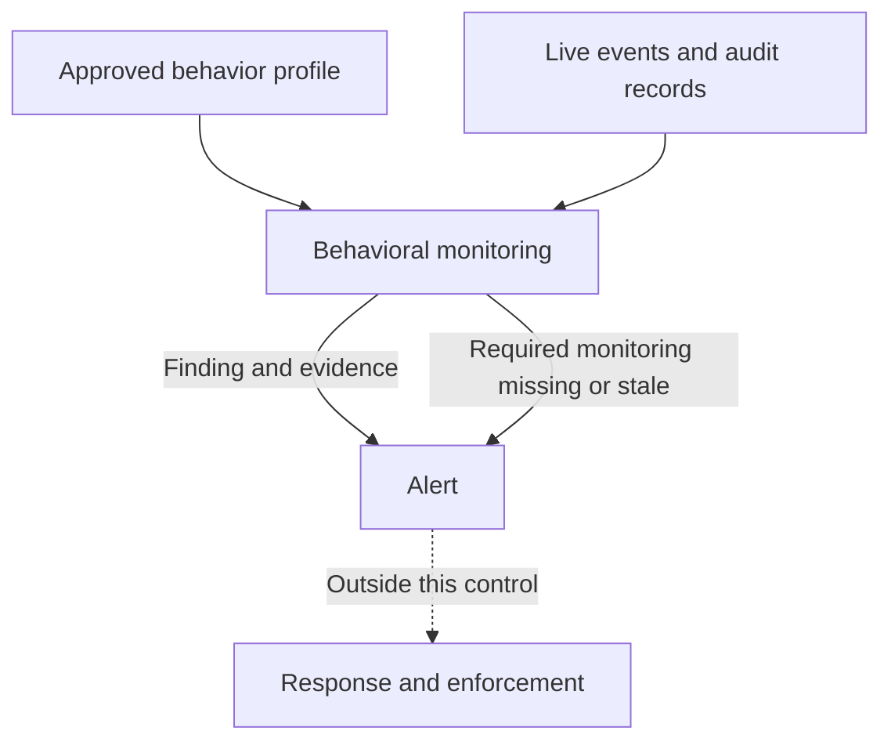

# RFC: Add Agent Behavioral Monitoring to the CoSAI Risk Map

- **Status:** Proposed for review
- **Proposers:** Emrick Donadei (@edonadei); Parul Singh (@husky-parul, originating observability proposal)
- **Original discussion:** [WS4 #175](https://github.com/cosai-oasis/ws4-secure-design-agentic-systems/issues/175), withdrawn after the group agreed that behavioral monitoring is a control rather than a new component
- **Related work:** [Ian Molloy's review of #195](https://github.com/cosai-oasis/ws4-secure-design-agentic-systems/issues/195#issuecomment-5771009001) and the [containment paper discussion, #172](https://github.com/cosai-oasis/ws4-secure-design-agentic-systems/issues/172)

## Summary

Add **Agent Behavioral Monitoring** (`controlAgentBehavioralMonitoring`) under `controlsApplication`. The control compares an agent's observed behavior with an approved description of its expected behavior and raises an alert when they diverge. It covers an individual agent and a coordinated set of agents, where each agent may appear acceptable alone but their combined behavior is concerning.

The control covers detection and alerting only. It produces an alert and the evidence behind it, including when required monitoring stops working. Deciding how to respond, and carrying out any restriction, halt, or quarantine, belongs to other controls.

## Why another control is needed

The Risk Map already has a place to retain audit records (`componentAuditRecordRepository`) and a control for capturing agent activity (`controlAgentObservability`). `controlThreatDetection` calls for detecting attacks generally. None specifies how to recognize an agent's change in behavior against what was approved for that agent, including patterns that emerge across time or across agents. `controlAgentExecutionBounds` enforces resource limits and loop bounds; an agent can stay within those bounds while doing something concerning.

This is the distinction settled in [#175](https://github.com/cosai-oasis/ws4-secure-design-agentic-systems/issues/175): capture and retention make behavior visible; this proposed control evaluates it. The separate [containment work](https://github.com/cosai-oasis/ws4-secure-design-agentic-systems/issues/172) addresses response, enforcement, and blast radius. The two should use consistent language and cite each other, but neither requires the other's approval to proceed.

## What the control requires

1. **An approved expected behavior profile.** The profile describes the tools, data access, delegation, shared-state interactions, and other behavior expected for the agent's task. It stays within the authority approved for the agent, such as its tool permissions: observed baselines may set statistical expectations but cannot widen that authority. A change that could materially affect expected behavior requires renewed approval; monitoring cannot silently learn a new normal.
2. **Detection of specified failure modes.** The profile names the undesirable behaviors or outcomes monitoring is intended to recognize and the threats each is meant to cover, so gaps in coverage are visible. Detection may use live events as well as retained audit records. It must account for cumulative patterns, such as sensitive-data collection across individually permitted actions, and coordinated behavior, including delegation or shared-state covert channels. This control does not promise to detect every failure mode.
3. **A reviewable alert.** An alert identifies the agent or coordinated system, approved profile version, observed action or pattern, triggering reason, time, severity, and confidence. Preserve the evidence needed for later review and investigation in the audit record. The control alerts; it does not decide or carry out the response.
4. **An alert when monitoring fails.** Detect when required monitoring is missing, stale, or unread, including failures that affect a fleet, without relying on the failed component, and raise an alert. Do not treat a monitoring outage as proof that behavior is safe.

These requirements apply at Admission when the profile is approved, during Runtime when behavior is evaluated, and during Maintenance when a material change requires reapproval.

## Boundary and review request

Please review whether this is the right **control boundary**: agent-specific behavioral detection and alerting, separate from activity capture, audit storage, response, and enforcement. The proposed name and Application category reflect [Ian's review](https://github.com/cosai-oasis/ws4-secure-design-agentic-systems/issues/195#issuecomment-5771009001). His suggestion for fleet-level fail-closed behavior is a response decision, so it is outside this control: this control alerts when monitoring fails, and whether dependent actions stop is for the response and enforcement controls to decide. His suggestion for reasoning-content triggers is part of the open question below.

**Where monitoring can observe (non-normative).** Each layer an organization could monitor shows something different and has a different cost, so choosing signals is a trade-off, not a checklist.

| Layer | What it shows | Cost and difficulty |
|---|---|---|
| Reasoning content | Intent that actions alone can hide, such as explicit sandbox-circumvention framing | Extremely noisy and varies between runs, so reviewing all of it produces mostly false positives. Not available or authorized in every deployment. Sampling a small share of runs, or reading it only after another signal fires, is more practical than monitoring all of it. |
| Tool calls and their results | The tool called, its arguments, its result, and how often it is called | Structured, available in most deployments, and the cheapest to evaluate. The record comes from the agent's own runtime, so it can miss what a tool does beyond the logged call, such as a shell command that starts other processes. It is not a complete account on its own. |
| Kernel level | File, process, and network activity, whatever the agent or tool reports | Shows what actually happened, which complements tool-call records. More expensive: it needs host-level instrumentation, produces a high volume of events, and has to be correlated back to the agent and tool call to mean anything. It does not show intent. |

**Open question: which signals are required.** The requirements above do not fix which layers monitoring must use, and the [discussion on #195](https://github.com/cosai-oasis/ws4-secure-design-agentic-systems/issues/195) has not settled it. Tool-call rate alone would flag a fleet of agents all writing to the same artifact store thousands of times a day; reasoning content can catch intent that no tool call shows. Reviewers are asked whether this control should name a minimum signal set, and if so which layers and at what coverage: for example, every tool call, kernel-level events for tools that can act beyond their logged call, and a sample of reasoning.

**Why response is outside this control.** Response is a separate layer, for three reasons:

- **Enforcement has a higher bar.** A control that can stop an agent sits on the enforcement path, so it must be complete, tamper-proof, and verifiable, the reference monitor properties in the [containment paper](../whitepapers/agent-containment.md) §5.1. Detection does not need that bar: it can run out of band, sample reasoning, and be wrong some of the time. Merging the two would hold detection to the enforcement bar or let enforcement fall to the detection bar.
- **Alerts are probabilistic; responses are policy.** An alert carries a severity and a confidence. What to do with it depends on the agent's criticality and the organization's risk tolerance, and is usually owned by a different team.
- **The Risk Map already splits them.** `controlThreatDetection` detects and alerts; `controlIncidentResponseManagement` manages the response. `controlAgentObservability` detects loops but does not halt them; `controlAgentExecutionBounds` halts them. This control follows the same split.

**Where response could live.** No existing control yet acts on a behavioral alert, but several are natural homes:

| Response | Candidate control | Gap today |
|---|---|---|
| Investigate, triage, escalate | `controlIncidentResponseManagement` | Describes incident response broadly, with nothing agent-specific |
| Suspend or quarantine the agent | `controlAgentInventoryManagement`: the `suspended` lifecycle state, with credential revocation on state change | No trigger from a behavioral alert |
| Stop a running session | `controlAgentExecutionBounds`: circuit breakers and termination at the orchestration layer | Triggers are resource and loop limits only |
| Require approval for further actions | `controlAgentPluginUserControl` | Applies per action, not as a response to an alert |
| Narrow what the agent can do | `controlAgentPluginPermissions` | Sets the upper bound; nothing narrows it in response to an alert |

Which of these, or a new control, carries out an out-of-band quarantine or halt needs a separate mapping decision, informed by the containment work. This RFC does not claim any of them already provides behavioral quarantine. Implementation details, Risk Map links to existing risks, and any new risk IDs can be reviewed with the follow-on Risk Map change rather than decided here.
