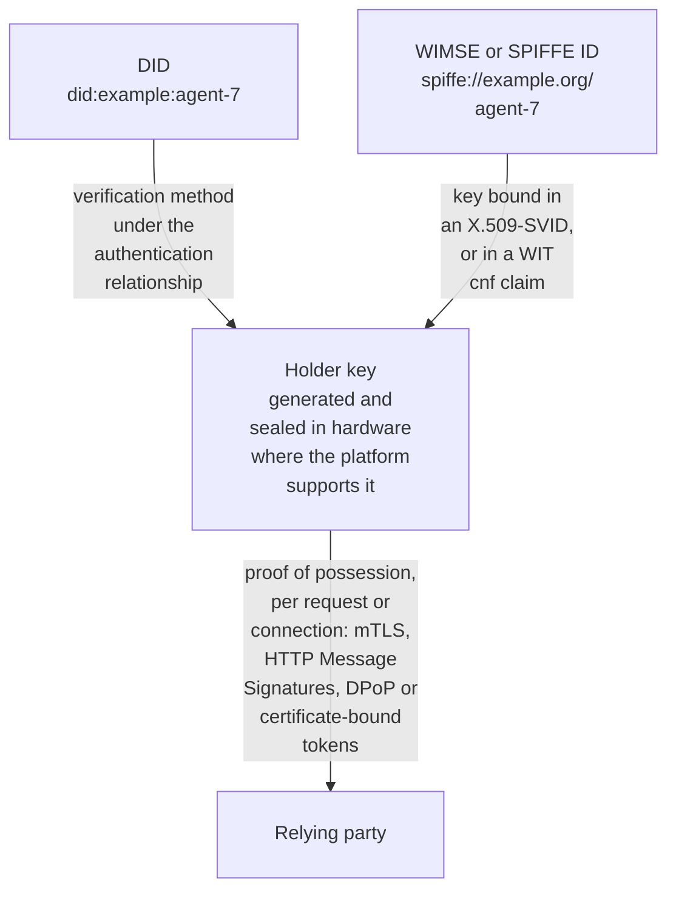
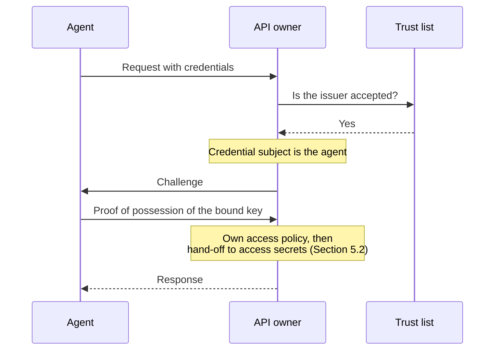
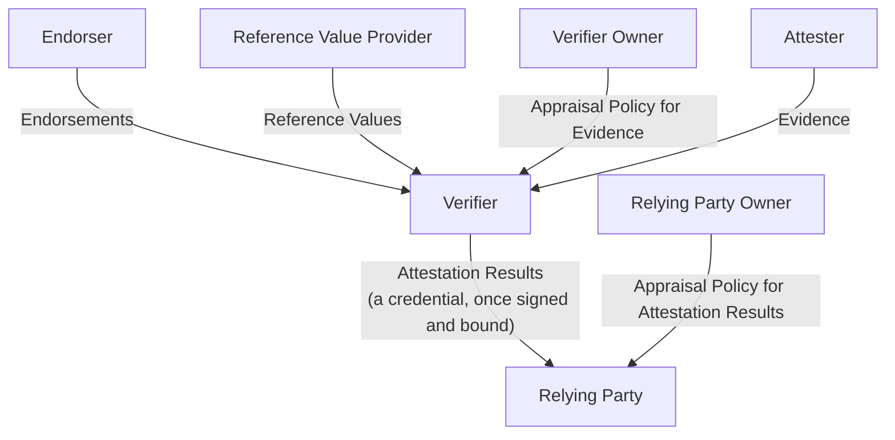

# Introduction

AI agents need a portable, verifiable way to present claims about themselves, so that the emerging ecosystem of gateways, other agents, and policy enforcement points can use those claims to decide what an agent may access and what it may delegate. Today, claims are expressed inconsistently across:

- Identifiers:
  - SPIFFE IDs [[SPIFFE](https://spiffe.io/docs/latest/spiffe-about/overview/)]
  - DIDs [[W3C-DID](https://www.w3.org/TR/did-core/)]
- Schemas:
  - ODIS Agent Runtime Credential [[ODIS](https://github.com/cosai-oasis/ws4-odis)]
  - A2A Agent Card [[A2A](https://a2a-protocol.org/latest/specification/)]
  - OASF [[OASF](https://docs.agntcy.org/oasf/open-agentic-schema-framework/)]
- Packaging formats:
  - W3C VCs [[W3C-VC2](https://www.w3.org/TR/vc-data-model-2.0/)]
  - JWTs [[RFC7519](https://www.rfc-editor.org/rfc/rfc7519)]

There is no shared classification of what kinds of credentials exist, such as identity, composition, capabilities, security posture, and delegation, or of how they relate. Every issuer and verifier must therefore build bespoke integrations, which blocks interoperability across organizations.

The gap is visible in today's deployments ([Section 4.1](#41-where-agents-need-credentials)). An agent invoked by a developer often acts under the developer's session. Consequently, every session interaction performed by the agent is recorded under the developer's name, not the agent's. Inside an organization, agents often authenticate by a shared secret or network position, which identifies a path rather than an agent. An agent that crosses into another organization arrives with nothing the receiver can evaluate: what model, tools, and configuration it runs, who answers for it, or on whose behalf it acts. The 2026 incidents behind [Section 6](#section-6-threat-models--recommendations) share one pattern: a check passed and said nothing about what was actually done.

The CoSAI Agentic Identity and Access Management paper [[COSAI-AIAM](https://www.coalitionforsecureai.org/wp-content/uploads/2026/04/agentic-identity-and-access-control.pdf)] addresses agent identity and access authorization to resources. Its Section 3.1, "Agents as first-class identities", sets out a high-level purpose of agent credentials:

> "[…] each agent MAY carry a set of informational attributes as claims that inform access-control decisions. These claims encompass:
>
> - Static attributes: code hash, model version, toolset, skill set, knowledge bases, and configuration parameters.
> - Dynamic context: operating environment, current task, in-memory state, risk tier, and behavioral state.
> - Delegation information: the principal on whose behalf the agent acts and the scope of that delegation.
>
> Enterprise policies MAY designate certain claims as mandatory."

This paper builds on that description of "claims that inform access-control decisions" to develop a framework for agent credentials. The framework defines a common core that others may extend with profiles for specific use cases. It provides a shared taxonomy, explains how agents are identified and how a credential is bound to the agent presenting it, names the standards available for each, and gives deployment patterns and worked examples for common cases.

This paper is intended for practitioners and vendors who build or integrate agent identity and management systems, and who face a fragmented set of standards and vendor approaches. It uses one shared vocabulary, drawn mainly from the IETF RATS architecture [[RFC9334](https://www.rfc-editor.org/rfc/rfc9334)] and various credential standards, so readers can map products and specifications onto a common framework. Readers do not need deep prior knowledge of RATS, WIMSE and SPIFFE, VCs, or DIDs, but are assumed to have some familiarity with them. Acronyms are expanded in the glossary in [Appendix A](#appendix-a-glossary). The examples, standards, and specifications named in this paper, whether published or in draft, are illustrative, not exhaustive and should not be taken as specific endorsements by OASIS, CoSAI or the authors.

# Section 1: Scope & Definitions

## 1.1 Scope

This paper engages with agent identity and credentials needed to sufficiently describe an agent, including what the agent is, who owns and sponsors it, claims to its capabilities, execution environment details, and its basis for verification provenance through appraisal and/or assurance.

This paper does not engage with access secrets, such as API keys, OAuth access tokens, and other bearer artifacts used to reach a downstream resource. These are out of scope and remain the domain of existing mechanisms such as OAuth 2.1 [[draft-ietf-oauth-v2-1](https://datatracker.ietf.org/doc/draft-ietf-oauth-v2-1/)], OAuth 2.0 Token Exchange [[RFC8693](https://www.rfc-editor.org/rfc/rfc8693)], Transaction Tokens [[draft-ietf-oauth-transaction-tokens](https://datatracker.ietf.org/doc/draft-ietf-oauth-transaction-tokens/)], and workload identity federation. This document defines the hand-off point to those access mediation and authorization mechanisms ([Section 5.2](#52-presentation-and-validation)), but does not specify them.

The key words "MUST", "MUST NOT", "REQUIRED", "SHALL", "SHALL NOT", "SHOULD", "SHOULD NOT", "RECOMMENDED", "NOT RECOMMENDED", "MAY", and "OPTIONAL" in this document are to be interpreted as described in BCP 14 [[RFC2119](https://www.rfc-editor.org/rfc/rfc2119)] [[RFC8174](https://www.rfc-editor.org/rfc/rfc8174)] when, and only when, they appear in all capitals, as shown here.

## 1.2 Core Concepts & Definitions

This section defines the core roles and concepts used throughout this document to describe how agent credentials are produced and used. Roles identify the parties that participate in the process of credential issuance and verification. Concepts describe the key artifacts and processes common to each implementation.

### Roles

The roles used in these definitions, including attester, endorser, verifier, and relying party, follow the IETF RATS architecture and its definitions [[RFC9334](https://www.rfc-editor.org/rfc/rfc9334)]. [Appendix B](#appendix-b-rats-architecture-and-role-mapping) shows the RATS architecture (Figure 1) and maps each of its roles and messages to its counterpart in this paper.

#### Attester

An attester is a role taken on by an entity whose evidence a verifier must appraise to judge how far that entity can be trusted. In practice, an attester usually has at least one attesting environment that can be trusted by a verifier through endorsements, which collects claims about one or more target environments and signs them. An attester produces evidence.

#### Endorser

An endorser is a role taken on by an entity, usually a manufacturer, whose endorsements help verifiers judge whether evidence is authentic and infer further capabilities of the attester.

#### Verifier

A verifier is a role taken on by an entity that appraises the validity of an attester's evidence and produces attestation results for relying parties to use. To do this, it applies an appraisal policy for evidence against the input evidence, together with any endorsements from endorsers and reference values, to produce the attestation results.

A verifier that issues its attestation results as a credential according to requirements specified in this paper is the producer of credentials. For example, this may be a remote attestation service or a software library for evidence appraisals.

#### Relying Party

The entity that receives a verified result and applies its owner's appraisal and authorization policy for a specific requested action. The relying party does not trust a credential solely because its signature is valid, but because it trusts its set of verifiers and their appraisal integrity.

A relying party that handles credentials issued by one or more verifiers, internal or external, according to requirements specified in this paper is the consumer of agent credentials. For example, this may be an agent gateway or secrets vault.

### Concepts

These concept definitions are drawn mainly from the IETF RATS architecture [[RFC9334](https://www.rfc-editor.org/rfc/rfc9334)], which supplies the core vocabulary of claim, evidence, endorsement, attestation result, and attestation. The terms subject and issuer are aligned with the identity and credential ecosystem, specifically W3C VCs [[W3C-VC2](https://www.w3.org/TR/vc-data-model-2.0/)], JWT [[RFC7519](https://www.rfc-editor.org/rfc/rfc7519)], X.509 [[RFC5280](https://www.rfc-editor.org/rfc/rfc5280)], and SCITT [[RFC9943](https://www.rfc-editor.org/rfc/rfc9943)].

The definitions of credential and agent credential are this document's own composition: a credential is treated as a signed attestation result issued by a RATS verifier and expressed in a portable document, so that RATS appraisal semantics can travel to downstream relying parties. An agent credential further aligns with the agent credentials of the IETF WIMSE AIMS draft [[draft-ietf-wimse-aims](https://datatracker.ietf.org/doc/draft-ietf-wimse-aims/)].

#### Subject

A subject is the entity a claim is about. A subject MAY be a user, an agent, a system, a software component or a hash of one, a body of data, or any other identified resource, such as one named by a UUID. The subject need not be an actor that performs actions; its purpose is to serve as an anchor for a claim against the entity being described.

This is an equivalent concept to the W3C VC credentialSubject [[W3C-VC2](https://www.w3.org/TR/vc-data-model-2.0/)], the JWT sub claim [[RFC7519](https://www.rfc-editor.org/rfc/rfc7519)], and the subject of a SCITT Signed Statement [[RFC9943](https://www.rfc-editor.org/rfc/rfc9943)].

#### Issuer

An issuer is the party that signs a set of claims into evidence or a credential and thereby vouches for them to an appraising party. The issuer's signature is what protects the signed claims.

An issuer in this document corresponds to the issuer role in the W3C VC data model [[W3C-VC2](https://www.w3.org/TR/vc-data-model-2.0/)] and to the signing authority in X.509 [[RFC5280](https://www.rfc-editor.org/rfc/rfc5280)].

#### Claim

A claim is a piece of information asserted. A claim says nothing by itself about who asserted it, to whom, or how it is protected.

#### Evidence

Evidence is a set of claims produced by an attester about a subject entity, intended to be appraised by a verifier. Evidence is input to verifier appraisal, not a conclusion about trustworthiness. What makes claims into evidence is their source (the attester), their direction (attester to verifier), and the protection that binds them to the attester's key.

Evidence typically includes configuration data, software measurements, telemetry, or supply-chain provenance, such as a workload-identity signal or a TEE quote. For example, an agent provider may issue an evidence document according to the attribute profile of an A2A Agent Card [[A2A](https://a2a-protocol.org/latest/specification/)], which describes the agent's identity, capabilities, skills, endpoints, and authentication requirements. The document MUST reference the attribute profile, be bound to the agent identity as subject, and be signed by the provider as attester.

#### Attestation Result

A statement by a verifier that vouches for, or denies, the validity of evidence against a stated policy. It may be a simple pass/fail or a richer set of claims, such as a score, about the subject, and can be vendor-neutral even when the evidence is vendor-specific. It MAY reference or embed the evidence it was derived from.

An attestation result holds only against the threat model of the appraisal it records. For example, a hardware-rooted result is strong against remote and software adversaries but bounded by the physical threat model of the device.

#### Endorsement

An endorsement is a signed statement from a trusted party (an endorser, e.g. a hardware manufacturer, platform operator, or attestation service) that vouches for the capabilities or trustworthiness of an attester. Endorsements are what let a verifier trust a given signer's keys and outputs, within the scope of its capabilities, in the first place.

Endorsement supplies the signer trust that lets a verifier appraise evidence, which is distinct from evidence and from attestation results. A credential signed by a trusted entity is generally treated as lower risk than one signed by an unknown party. A credential MAY record which endorsement it was appraised against, since an endorsement chain is not always resolvable at verification time.

#### Attestation

Attestation is the process of appraising evidence against reference values ("known-good" measurements) and an appraisal policy conducted by a verifier, in order to reach a conclusion about the subject entity. Appraisal is the evaluation step at the core of this process: the comparison of evidence against those reference values.

The output of that process is an attestation result, which is not a credential in itself. When the verifier signs that attestation result, and binds it to the subject and policy, it becomes a credential.

#### Credential

A credential is a signed attestation result that binds a subject identity to a set of claims upon policy appraisal. It is issued by a verifier, and is intended to be presented to and verified by a relying party. A credential is meant to travel and be verified downstream.

Evidence MAY be referenced or embedded in the credential, allowing independent appraisal downstream when deemed necessary. A verifier SHOULD also indicate an assurance level of its appraisal process, which allows relying parties to infer the adversary class it holds against.

For example, a verifier checks that the subject agent identity is registered to a trusted registry, and issues a credential containing the attestation result, agent identity as subject, as well as the policy reference. It MAY reference the membership evidence as part of the credential.

#### Agent Credential

A credential whose subject is an agent, named by an agent identifier. An agent credential MUST be cryptographically bound to a key controlled by the subject, so that presentation can require proof of possession, and MUST carry an explicit expiration. In workload identity systems, the verifier role is typically performed by the credential provisioning component (e.g. a SPIFFE/WIMSE issuer, or a VC issuer for DID-identified agents), and the appraisal it performs corresponds to posture assessment.

This definition is consistent with agent credentials described in AIMS and extends that model to agent identifiers beyond the WIMSE identifier that AIMS mandates, such as DIDs.

# Section 2: Credential Taxonomy

[Section 1](#section-1-scope--definitions) defined an agent credential as a verifier's signed appraisal of an agent. This section turns that definition into content: which claims an agent credential carries, and what tells a relying party how far to trust them. A shared set of claim categories lets relying parties state requirements against common fields instead of negotiating them per integration.

## 2.1 What an Agent Credential Carries

Whatever claims it adds, every credential carries the core in Table 1.

*Table 1: Core fields of a credential*

| Field | Requirement | Notes |
|---|---|---|
| Subject | MUST | MUST support proof of possession for actors, described in [Section 3.2](#32-key-binding-profiles-and-packaging) |
| Profile | MUST | Described in [Section 3.2](#32-key-binding-profiles-and-packaging) |
| Result | MUST | Schema defined per profile |
| Evidence (referenced or embedded) | SHOULD | MAY, if not intended to cross trust domains |
| Assurance basis | SHOULD | Include: attestation tier, appraisal policy, appraisal time described in [Section 2.2](#22-how-far-a-relying-party-can-trust-it) |
| Issuer | MUST | The verifier identity |
| Issued | MUST | The time of issuance |
| Expiry | MUST | The time of expiry |
| Revocation | SHOULD | MAY, if short-lived |
| Signature | MUST | As supported by packaging format in [Section 3.2](#32-key-binding-profiles-and-packaging) |

An agent is a composition of parts that change on independent schedules: model, tools and skills, configuration, execution environment, and the principal it acts for. A credential needs enough granularity that a change to one part does not invalidate claims about the others.

Each category below can be a standalone credential or a group of fields. Categories overlap; one credential may carry fields from several when the issuer has authority over all of them. An enterprise MAY designate fields as mandatory in its appraisal policy.

Named credential profiles appear at the end of each category. A profile is a fixed set of fields with defined semantics so relying parties can request and appraise it by name.

**Identity and ownership.** These fields say who the agent is and who answers for it. They change only when the agent is retired, transferred, or redefined.

- **Agent identifier:** Stable logical identifier, independent of any running instance. SHOULD be resolvable: a DID [[W3C-DID](https://www.w3.org/TR/did-core/)], SPIFFE ID [[SPIFFE](https://spiffe.io/docs/latest/spiffe-about/overview/)], or WIMSE workload identifier [[draft-ietf-wimse-arch](https://datatracker.ietf.org/doc/draft-ietf-wimse-arch/)]. Bare UUIDs are NOT RECOMMENDED across domains; nothing resolves them.
- **Runtime instance identifier:** UUID for one running instance. Ephemeral.
- **Ownership:** The organization accountable for the agent. Distinct from the operator (runs it) and the principal (invokes it). Basis for audit and incident attribution.
- **Sponsorship:** When deployed for a third party, the sponsor SHOULD be identified separately from the owner.
- **Metadata:** Name, version, description, endpoint. Supports discovery.

*Profile: verified-ownership. An issuer attests that a named organization controls the subject key.*

**Composition.** Identity says which agent this is; composition says what it is currently made of. Each component is identified by a content-addressed digest that SHOULD pin a specific artifact, not a mutable tag: the model, with weights provenance (e.g. Sigstore model signing [[SIGSTORE](https://github.com/ossf/model-signing-spec)]); the software, code or container image, with SLSA build provenance [[SLSA](https://slsa.dev/spec/v1.2/)]; the resolved tool and skill manifest; the configuration (system prompt, decoding parameters, and guardrails), which relying parties with behavioral requirements SHOULD verify; and the knowledge-base snapshot, with version and ingestion time. Identity is stable; composition is mutable. A composition fingerprint over all components ([Section 3.1](#31-identifying-the-agent)) changes when any component changes, so swapping a model or revoking a tool invalidates the composition claim without invalidating the agent's identity.

For example, the following credential indicates a verifier has appraised the evidence, and claims the subject's boot components match approved software identities:

```
Subject:   "did:key:<subject-pubkey>"
Profile:   "golden-image"
Images:    {
   "ovmf":   ["sha256:<ovmf-hash>"],
   "kernel": ["sha256:<kernel-hash>"],
   "initrd": ["sha256:<initrd-hash>"],
   "append": ["sha256:<append-hash>"],
   "rootfs": ["sha256:<rootfs-hash>"]
}
Result:    { "value": true, "method": "tee" }
Evidence:  [{ "type": "AmdSevEvidence", "amdSevReport": "sha256:<report-hash>" }]
…
```

*Profiles: agent-composition (digests of model, resolved tool and skill manifest, knowledge-base snapshot, prompt and guardrail configuration, plus a fingerprint over all of them); approved-config (configuration digest matches an approved reference); contain-guardrails (a named guardrail set is present in the active configuration); golden-image (boot components match approved measurements; see [Appendix E](#appendix-e-example-evidence-and-credentials), Example 3).*

**Capabilities and skills.** Composition records the parts; capabilities record what those parts are designed to do: function, not permission ([Section 1.1](#11-scope)). Declared capabilities are structured flags from a standard vocabulary, such as the A2A Agent Card [[A2A](https://a2a-protocol.org/latest/specification/)]; other descriptor formats are in [Appendix D](#appendix-d-agent-descriptor-formats). Skills are either assigned statically at registration, which records intent but not the implementing artifact, or validated dynamically, where a verifier appraises a signed manifest of active skill artifacts at or near runtime. Profiles SHOULD state which form they carry.

*Profiles: approved-skills (each active skill artifact digest matches an approved reference); validated-capabilities (declared capabilities were exercised and confirmed by a verifier).*

**Security and compliance posture.** This category describes not the agent's design but its observed condition.

- **Security scan and policy compliance:** A malware or vulnerability scan, or an evaluation against a named framework (e.g. HIPAA technical safeguards [[HIPAA](https://www.ecfr.gov/current/title-45/subtitle-A/subchapter-C/part-164/subpart-C/section-164.312)], or the CoSAI Risk Map [[COSAI-RM](https://github.com/cosai-oasis/secure-ai-tooling)]). SHOULD name the framework and version, evaluator, scope, and date.
- **Runtime environment:** The execution environment and the attestation tier covering it ([Section 2.2](#22-how-far-a-relying-party-can-trust-it)).
- **Risk and trust score:** Relying parties SHOULD NOT accept a score that omits the scoring method and version, evidence window, verifier, or attestation tier. A score SHOULD be a decomposable vector, with the verifier committed to the evidence behind it so specific claims can be challenged through selective disclosure.

For example, the following credential indicates a verifier has appraised the evidence, and claims the subject is present in a named registry at a stated content digest:

```
Subject:      "did:key:<subject-pubkey>"
Profile:      "registry-membership"
Registry:     "https://assets.radar.cloudflare.com/bots/signature-agent-registry.txt"
RegistrySRI:  "sha256:<registry-content-digest>"
Result:       true
…
```

*Profiles: security-scanned (named scanner, version, and clean result on a stated artifact digest); trust-score (score plus the four fields above); registry-membership (subject is present in a named registry at a stated content digest; see [Appendix E](#appendix-e-example-evidence-and-credentials), Example 2).*

**Delegation.** Delegation has two sides. The credential side, the "delegation information" of the CoSAI Agentic IAM paper [[COSAI-AIAM, Section 3.1](https://www.coalitionforsecureai.org/wp-content/uploads/2026/04/agentic-identity-and-access-control.pdf)], says whom the agent acts for, the chain of agents it acts through, and the bounds on that chain. A verifier can attest these claims and bind them to the agent like any other. The authorization side, the access tokens that carry permissions, is out of scope.

When agent A invokes agent B, A does not hand over its own credential, which would destroy attribution and give B everything A holds. B's credential instead carries a resolvable principal reference, the chain of actors, and its depth, so a relying party can reconstruct "B, acting for A, acting for the original principal".

Each hop's authority is contained in its delegator's. The credential states the bound, and the authorization side enforces it, for example with RAR [[RFC9396](https://www.rfc-editor.org/rfc/rfc9396)], caveats [[MACAROONS](https://www.ndss-symposium.org/ndss2014/programme/macaroons-cookies-contextual-caveats-decentralized-authorization-cloud/)], or resource indicators [[RFC8707](https://www.rfc-editor.org/rfc/rfc8707)]. Narrowing SHOULD be checked by the issuing authority, not asserted by the delegating agent, whose model can be manipulated, and again at the enforcement point.

These five categories are not exhaustive. Profiles MAY define further categories, such as domain-specific credentials, provided each claim is bound to the subject and issued by a verifier.

## 2.2 How Far a Relying Party Can Trust It

Two credentials with identical claims can deserve very different trust, depending on what the verifier was able to check. This subsection names the tiers that capture that difference and the fields that carry it in the credential.

**Attestation tiers.** Assurance depends on where evidence is rooted [[RFC9334, Section 12.1](https://www.rfc-editor.org/rfc/rfc9334#section-12.1)]. Each of three tiers holds against a different adversary:

- **Software.** The agent process reports on itself; anyone with code execution in the process can forge it.
- **Platform.** The platform asserts identity and environment, for example through SPIRE workload attestation [[SPIFFE](https://spiffe.io/docs/latest/spiffe-about/overview/)] or cloud managed identities. Holds against a compromised agent process, not a compromised platform.
- **Hardware.** A hardware root of trust signs a measurement of the environment, for example Intel TDX [[INTEL-TDX](https://www.intel.com/content/www/us/en/developer/tools/trust-domain-extensions/overview.html)], AMD SEV-SNP [[AMD-SEV](https://docs.amd.com/v/u/en-US/SEV-SNP-strengthening-vm-isolation-with-integrity-protection-and-more)], or TPM quotes [[TCG-TPM2](https://trustedcomputinggroup.org/resource/tpm-library-specification/)]. Holds against software and privileged-operator adversaries.

Table 2 summarizes the three tiers, together with the physical-owner limit that [Section 1.2](#12-core-concepts--definitions) places on a hardware-rooted result.

*Table 2: Attestation tiers and the adversaries they hold against*

| Tier | Remote attacker | Compromised agent process | Privileged operator | Physical owner |
|---|---|---|---|---|
| Software | Yes | No | No | No |
| Platform | Yes | Yes | No | No |
| Hardware | Yes | Yes | Yes | No |

**Assurance basis.** A tier is only useful to a relying party if the credential says which one applied. An agent credential SHOULD therefore carry the assurance level of its appraisal ([Section 1.2](#12-core-concepts--definitions)) as an assurance basis, so a relying party can apply different thresholds to different actions ([Section 5.2](#52-presentation-and-validation)) without repeating the appraisal:

- **Attestation tier** of the evidence appraised.
- **Appraisal policy** identifier and version.
- **Appraisal time.** A credential can be unexpired while its appraisal is stale; a relying party SHOULD treat appraisal time as an input to its own policy.

A profile for a format without one, such as X.509-SVIDs or WIMSE WITs [[draft-ietf-wimse-workload-creds](https://datatracker.ietf.org/doc/draft-ietf-wimse-workload-creds/)], MAY state a default; otherwise a relying party MUST treat a credential with no assurance basis as no stronger than the software attestation tier. [Appendix E](#appendix-e-example-evidence-and-credentials) shows one evidence document and two agent credentials, at the software and hardware tiers, each with its assurance basis.

For example, the following assurance basis claim asserts that a hardware attestation tier of evidence was used in the appraisal, against the golden-image/v1 policy, with an appraisal time for relying parties to evaluate credential freshness:

```
Assurance basis:  tier "hardware",
                  policy "golden-image/v1",
                  appraisal time 2026-08-06T13:59:40Z
```

# Section 3: Identity & Credential Formats

[Section 2](#section-2-credential-taxonomy) described what an agent credential carries. This section covers the mechanics that make those claims usable: how the agent is named, how a presenter proves it is that agent, and how the claims are packaged so another party can verify them.

## 3.1 Identifying the Agent

An agent needs a name that outlives any one running copy, and a way to tell when the entity behind that name has changed. A running copy is named by the runtime instance identifier of [Section 2.1](#21-what-an-agent-credential-carries).

**Durable agent identifiers.** Two families of standards fit the identifier of [Section 2.1](#21-what-an-agent-credential-carries) for an agent:

- **DIDs** [[W3C-DID](https://www.w3.org/TR/did-core/)] are durable, resolvable, and portable, and pair naturally with VCs [[W3C-VC2](https://www.w3.org/TR/vc-data-model-2.0/)]. A verification method in the DID document, under its authentication relationship, is the holder key used for proof of possession ([Section 3.2](#32-key-binding-profiles-and-packaging)).
- **WIMSE and SPIFFE IDs** [[draft-ietf-wimse-arch](https://datatracker.ietf.org/doc/draft-ietf-wimse-arch/)] [[SPIFFE](https://spiffe.io/docs/latest/spiffe-about/overview/)] are workload identifiers issued with short-lived SVIDs and federated across trust domains. A WIMSE identifier is what AIMS [[draft-ietf-wimse-aims](https://datatracker.ietf.org/doc/draft-ietf-wimse-aims/)] mandates. The holder key is the key bound in an X.509-SVID or in a WIT's cnf claim.

  JWT-SVIDs are bearer tokens with no key binding, and so do not meet the agent credential requirements of [Section 1.2](#12-core-concepts--definitions).

**Composition fingerprint.** A stable identifier creates its own risk: the agent behind it can change while the name does not. The composition fingerprint of [Section 2.1](#21-what-an-agent-credential-carries) makes that change visible. A mismatch means drift, not necessarily compromise: the composition claim no longer holds, but the agent identifier is unaffected. How to compute the fingerprint (canonical ordering of components, hash algorithm, optional fields) is not yet standardized ([Section 6.2](#62-open-gaps-and-recommendations)).

## 3.2 Key Binding, Profiles, and Packaging

A name alone proves nothing, since anyone can quote it. Three things turn a set of claims into something a relying party can rely on: a key that only the agent holds, a profile that tells it which fields to expect, and a signed format the relying party can parse.

**Key binding and proof of possession.** The key, not the identifier, is what anchors an agent credential, as its possession can be proven across domains, and the identifier is linked to that key as described in [Section 3.1](#31-identifying-the-agent).

A holder key MAY be a DID verification method [[W3C-DID](https://www.w3.org/TR/did-core/)], a JWK [[RFC7517](https://www.rfc-editor.org/rfc/rfc7517)], or an X.509 certificate [[RFC5280](https://www.rfc-editor.org/rfc/rfc5280)]. The agent MUST be able to answer a challenge proving possession of the key, and SHOULD do so per request or per connection: with mTLS or HTTP Message Signatures [[RFC9421](https://www.rfc-editor.org/rfc/rfc9421)] (profiled for workloads in [[draft-ietf-wimse-http-signature](https://datatracker.ietf.org/doc/draft-ietf-wimse-http-signature/)], alongside the WIMSE Workload Proof Token [[draft-ietf-wimse-wpt](https://datatracker.ietf.org/doc/draft-ietf-wimse-wpt/)]), or, where the credential is presented to an OAuth authorization server, with DPoP [[RFC9449](https://www.rfc-editor.org/rfc/rfc9449)] or certificate-bound tokens [[RFC8705](https://www.rfc-editor.org/rfc/rfc8705)], the binding profiles ODIS recognizes [[ODIS, Section 7.1.1](https://github.com/cosai-oasis/ws4-odis)].

Where the platform supports it, the private key SHOULD be generated and sealed in hardware, so possession also evidences the runtime environment ([Section 2.2](#22-how-far-a-relying-party-can-trust-it)). A key the agent process can export is a bearer secret with extra steps.

Figure 2 shows how each identifier family of [Section 3.1](#31-identifying-the-agent) leads to the holder key, and where proof of possession is checked.

*Figure 2: Agent identifiers, the holder key, and proof of possession*



**Profiles and registry.** A credential MUST carry a top-level type or profile field naming a registered profile (see [Appendix C](#appendix-c-named-credential-profiles)). The profile defines the required claims and verification rules, so a relying party can check a credential from an issuer it has never seen.

The profile registry SHOULD be openly governed, on the model of an IANA media-type registry [[IANA-MEDIA-TYPES](https://www.iana.org/assignments/media-types/)], not controlled by a single vendor; its governance is an open working-group question. OASF [[OASF](https://docs.agntcy.org/oasf/open-agentic-schema-framework/)] illustrates the pattern.

**Packaging.** The claims, with their key binding and profile, need a container that the relying party's tooling already understands. Packaging changes who can verify a credential, not what it claims, so it is kept separate from the claim schema.

- **W3C VCs** [[W3C-VC2](https://www.w3.org/TR/vc-data-model-2.0/)], with Data Integrity proofs [[VC-DATA-INTEGRITY](https://www.w3.org/TR/vc-data-integrity/)] or as JWT-VCs [[VC-JOSE-COSE](https://www.w3.org/TR/vc-jose-cose/)], where selective disclosure and cross-domain portability matter.
- **JWT** [[RFC7519](https://www.rfc-editor.org/rfc/rfc7519)] where existing OAuth infrastructure dominates.
- **EAT** [[RFC9711](https://www.rfc-editor.org/rfc/rfc9711)], a signed JWT or CWT [[RFC8392](https://www.rfc-editor.org/rfc/rfc8392)], where RATS tooling is in place. EAT is the RATS format for evidence; its EAR profile [[draft-ietf-rats-ear](https://datatracker.ietf.org/doc/draft-ietf-rats-ear/)] carries a verifier's result, and so packages a credential. EAR carries the appraisal policy in ear_appraisal_policy_ids; the other assurance-basis fields are additions.
- **X.509 certificates and X.509-SVIDs** [[RFC5280](https://www.rfc-editor.org/rfc/rfc5280)] [[SPIFFE](https://spiffe.io/docs/latest/spiffe-about/overview/)] where identity is consumed through existing mTLS and PKI. These carry no assurance basis unless a profile states a default ([Section 2.2](#22-how-far-a-relying-party-can-trust-it)).

Evidence MAY be rendered as a VC or an EAT, and credentials issued by verifiers as a VC or an EAR. Here is the same agent credential rendered as a VC and as an EAR, drawn from the examples in [Appendix E](#appendix-e-example-evidence-and-credentials).

As a VC:

```json
{
  "@context": [
    "https://www.w3.org/ns/credentials/v2",
    "https://example.org/vocab/registry-membership/v1"
  ],
  "type": ["VerifiableCredential", "RegistryMembership"],
  "issuer": "did:key:<verifier-pubkey>",
  "validFrom": "2026-08-06T14:00:00Z",
  "validUntil": "2026-08-06T18:00:00Z",
  "credentialSubject": {
    "id": "did:key:<subject-pubkey>",
    "profile": "registry-membership",
    "registry": "https://assets.radar.cloudflare.com/bots/signature-agent-registry.txt",
    "registrySRI": "sha256:<registry-content-digest>",
    "result": true
  },
  "assuranceBasis": {
    "attestationTier": "software",
    "appraisalPolicy": "https://example.org/policy/registry-membership/v1",
    "appraisalTime": "2026-08-06T13:59:40Z"
  },
  "proof": {
    "type": "DataIntegrityProof",
    "cryptosuite": "eddsa-jcs-2022",
    "created": "2026-08-06T14:00:00Z",
    "verificationMethod": "did:key:<verifier-pubkey>#z6Mk...",
    "proofPurpose": "assertionMethod",
    "proofValue": "<proof-over-all-above-fields>"
  }
}
```

As an EAR:

```json
{
  "eat_profile": "tag:ietf.org,2026:rats/ear#04",
  "iat": 1786024800,
  "exp": 1786039200,
  "iss": "did:key:<verifier-pubkey>",
  "sub": "did:key:<subject-pubkey>",
  "cnf": { "kid": "did:key:<subject-pubkey>#z6Mk..." },
  "ear_verifier_id": {
    "developer": "https://verifier.example.com",
    "build": "registry-membership-v1"
  },
  "submods": {
    "registry-membership": {
      "ear_status": "affirming",
      "ear_appraisal_policy_ids": ["https://example.org/policy/registry-membership/v1"],
      "attestation_tier": "software",
      "appraisal_time": 1786024780,
      "ear_verifier_claims": {
        "registry": "https://assets.radar.cloudflare.com/bots/signature-agent-registry.txt",
        "registrySRI": "sha256:<registry-content-digest>",
        "result": true
      }
    }
  }
}
```

# Section 4: Deployment Patterns & Gaps

Sections [2](#section-2-credential-taxonomy) and [3](#section-3-identity--credential-formats) described an agent credential in isolation. This section places it in real deployments: where agents act today without one, what changes when a credential crosses an organizational boundary, and where credentials alone stop being enough.

## 4.1 Where Agents Need Credentials

Most agent activity follows one of three deployment scenarios, and each shows a different cost of having no agent credential:

**(a) Agent invoked by a human principal, within one administrative domain.** The agent inherits its principal's session. Nothing distinguishes the agent from the human, or one agent from another under the same principal. The gap is attribution — after an incident, the record names the principal, not the agent that acted.

Example: A developer uses a coding agent and gives it the developer's own API key so that the agent can access a service.

**(b) Multiple agents in the same domain with shared identifiers — agents calling services or other agents.** Whether the callee is an API or another agent, the caller is authenticated by a shared secret or by network position. Every agent behind that boundary is indistinguishable. The transport is authenticated; the agent is not.

Example: Two agents originating from the same IP address, or signing with the same key (e.g. HTTP Message Signatures), cannot be told apart.

**(c) Agent unknown to the receiver, usually across an administrative boundary.** The receiving domain has no prior relationship with the calling agent and no basis on which to evaluate it.

The first two scenarios can be handled by giving each agent its own identity as described in [Section 3.1](#31-identifying-the-agent), and provisioning its own credential so that its actions are attributed to it; access tokens are then issued on that basis. Scenario (c) is where agent credentials have the most utility.

For example, an agent sends an HTTP request to an API endpoint that only accepts agents meeting certain standards (e.g. certified against a set of industry-accepted standards). The agent happens to already meet those requirements, and can present credentials. The API owner receives these credentials from the agent, verifies that the issuer is on its industry-accepted trust list, that the credentials are issued for the agent as credential subject, and that the agent proves possession of the bound key. The API owner then applies its own access policy, and the request proceeds to the hand-off to access secrets ([Section 5.2](#52-presentation-and-validation)).

Figure 3 shows this exchange. The API owner relies on the credential's claims only after the agent has proved possession of the bound key.

*Figure 3: An agent unknown to the receiver presents its credentials to an API (scenario c)*



In each case, the credentials travel in-band with the request, or by reference, in any packaging of [Section 3.2](#32-key-binding-profiles-and-packaging). These credentials may include credential types that are not agent credentials — not anchored on an agent subject, but on other components or attributes associated with the agent.

**Identity patterns.** A credential may be anchored on any of these identities. In other words, any of these can be the subject of a credential.

| Pattern | The credential subject identifier | Survives a domain crossing |
|---|---|---|
| Agent identity | The durable agent identifier ([Section 2.1](#21-what-an-agent-credential-carries), [Section 3.1](#31-identifying-the-agent)), such as a DID or WIMSE identifier | Yes, via holder key |
| Deployment identity | A registered deployment record — build identity plus configuration plus environment — under an identifier the deploying organization assigns (a SPIFFE ID path in its trust domain is the natural form) | Yes, if resolvable via federation |
| Software identity | The digest of a software build or image artifact | Yes, by measurement (a hash of the artifact, or a hardware-rooted measurement of it) |
| Delegated identity | The durable agent identifier ([Section 2.1](#21-what-an-agent-credential-carries), [Section 3.1](#31-identifying-the-agent)), with the principal and chain of actors it acts for carried as claims | Yes, if the principal reference resolves and the agent proves its holder key |

**Example: regulated finance.** Finance shows all of these needs at once, because its obligations are external and must be met long after the action. A financial institution must show after the fact which system acted, on whose behalf, running what, and under which approval. A collections agent crossing between institutions over a consumer-permissioned data network such as Akoya [[AKOYA](https://akoya.com/)] presents its holder key, an ownership claim, a capability claim, an image measurement, and its delegation record, and months later an auditor must still be able to resolve each of them, including credentials since revoked.

## 4.2 Crossing Domains

Scenario (c) is where agent credentials earn their place, and where the hardest questions sit: whether the receiver trusts the issuer, how it recognizes the agent under a different local name, and which issuers it accepts at all.

**Trust across boundaries.** The central case is an agent evaluated in one administrative domain and acted on in another. Three situations differ in what the relying party can accept:

- **Within one organization**, a shared root of trust exists, and the holder key reconciles differing local identifiers.
- **Across a trusted contractual or federated relationship**, the relying party can accept the originating verifier's conclusion.
- **At an untrusted hop**, it cannot: a forwarded conclusion asks it to trust that domain, while forwarded evidence lets it appraise independently.

A credential crossing an untrusted boundary SHOULD therefore carry, or be able to resolve, the evidence its claims were appraised from, so the relying party or a verifier it trusts can check it against its own reference values.

**Portability.** Whatever the trust relationship, the receiver must first establish that the agent in front of it is the one the credential describes. Continuity across domains rests on a cryptographic key, not a string: receiving domains assign their own local names, and the holder key ([Section 3.2](#32-key-binding-profiles-and-packaging)) shows that they refer to the same agent. During cross-domain validation, the relying party MUST bind the credential to the profile-defined subject and holder, authenticate current key material through an accepted trust anchor or federation, verify key status and rotation, establish the issuer's authority for each relied-upon claim, and apply local policy. It MUST NOT accept a credential on signature verification alone.

**Multiple issuers and private registries.** No single issuer will vouch for every agent, so each relying party has to choose whose word it takes. IdPs that issue agent credentials act as verifiers ([Section 1.2](#12-core-concepts--definitions)), and each relying party decides which issuers it accepts for which claims. An enterprise MAY run a private agent registry and issue registry-membership credentials (see [Appendix E](#appendix-e-example-evidence-and-credentials), Example 2) without disclosing its contents, provided the relying party accepts the verifier.

## 4.3 Putting Credentials to Work

The deployment analysis also points to three patterns where agent credentials do work no existing mechanism does. Where a gap remains, it is carried into [Section 6](#section-6-threat-models--recommendations).

**Issuer / observer model.** A credential need not originate with the agent's builder. A platform, network or gateway occupying a vantage point can observe behavior and record what it observed; a verifier, often the observer itself, appraises that record and issues a credential about it ([Section 1.2](#12-core-concepts--definitions)). This matters because the most operationally useful claims are ones an agent cannot self-assert honestly — what it actually did, how often, against which endpoints. A self-asserted claim of good behavior is unfalsifiable; an observer's record of what it saw is evidence, and a credential issued over that record can be appraised by a relying party in a way a self-assertion cannot.

Two constraints:

- The observer MUST be identified in the credential. "Observed at a gateway" carries no information without knowing which gateway, under which configuration.
- Observation is time-bounded. An observer-issued credential SHOULD describe a window, and the window belongs inside the claim.

Whether a relying party accepts an observer-issued credential is up to its appraisal policy.

**MCP tool use.** An MCP [[MCP](https://modelcontextprotocol.io/specification/2026-07-28/basic/authorization)] tool endpoint receiving a call from an unfamiliar agent needs the identifier, the holder key, and the capability claims relevant to that call. Ordering matters: claims are relied on only after proof of possession is verified. A valid credential presented by a party that cannot answer the challenge is a replay, and relying on claims before possession inverts the check.

MCP's authorization layer carries OAuth access tokens (out of scope, [Section 1.1](#11-scope)) but defines no carrier for the agent credential today.

**Security scan attestation claim on a software image.** An agent presents a claim that its image passed a vulnerability scan or safety evaluation. The attester produces evidence — scan output, measurements; a verifier appraises it against reference values and issues the result as a credential.

The requirement this case adds is that a result is interpretable only against what it was measured on. An evaluation or scan credential SHOULD identify what it was evaluated against: the reference values and the identity of the evaluation, namely suite or corpus identifier, harness version, and configuration. A bare score without its reference values is not verifiable.

## 4.4 Where Credentials Fall Short

The patterns above all assume the agent presents its credential, and that assumption is the main limit.

A credential only helps when it is presented. It states what a verifier appraised about an agent, not what the agent just did, and it does not constrain an agent that never presents. A compromised agent presents nothing, an intermediary that is not credential-aware can strip the credential, and tools reached outside the mediated route never pass a checkpoint. An observer ([Section 4.3](#43-putting-credentials-to-work)) that does not depend on the agent's cooperation can fill part of this gap; the rest is carried into [Section 6.2](#62-open-gaps-and-recommendations).

# Section 5: Credential Lifecycle & Enforcement

[Section 4](#section-4-deployment-patterns--gaps) showed where agents present credentials. This section follows one credential through its life: how it is issued, how it is presented, how a relying party validates what it receives, how it ends through expiry or revocation, and what is required when any of those steps cannot be completed.

## 5.1 Issuance

**Issuers.** An agentic system typically has three distinct issuer roles:

| Issuer role | What it issues | Trust basis |
|---|---|---|
| **Registration record issuer** | A durable identifier and registration record (static) for the agent: who or what this agent is | Human or organizational registration, software provenance, agent registries |
| **Runtime credential issuer** | A short-lived, key-bound credential for the running instance (workload identity); in [Section 1](#section-1-scope--definitions) terms, the verifier ([Section 1.2](#12-core-concepts--definitions)) | Appraisal of runtime or software evidence |
| **Authorization issuer (AS)** | Access tokens or authorization grants scoping what the instance may do (out of scope, [Section 1.1](#11-scope)) | Grant evaluation against policy |

Keeping these roles separate matters because they rotate on different clocks. Registration records are close to permanent, runtime credentials last minutes to hours, and access tokens often last seconds to minutes, especially for tool calls.

**Rotation and cascade.** When a registration record is revoked, credentials derived from it lose their basis. Profiles SHOULD state whether derived credentials are invalidated immediately or run to a maximum lifetime; high-sensitivity operations SHOULD cascade immediately ([Section 5.3](#53-expiry-and-revocation)).

## 5.2 Presentation and Validation

**Binding at presentation.** Holder binding is what keeps a stolen credential from being replayed ([Section 3.2](#32-key-binding-profiles-and-packaging)). The mechanisms trade off differently: DPoP signs every request but needs a replay window or server nonce; mTLS binds once per connection but breaks at a TLS-terminating proxy; HTTP Message Signatures survive intermediaries at a per-request signing cost.

Possession proves a key was used, not that it belongs to the intended software, so the runtime credential issuer requires attestation evidence before issuance and records the result in the assurance basis ([Section 2.2](#22-how-far-a-relying-party-can-trust-it)). An instance credential belongs to one instance: a re-created process presents a new key and re-attests rather than reusing what the previous instance held, and credentials bound to a rotated key cease to be presentable.

A relying party must verify the signature before it can check possession, since the key it checks against is inside the credential. The rule is about reliance, not parse order: no claim may be relied on for an authorization decision until holder binding is verified, and a credential whose signature verifies but whose binding fails is recorded as a replay.

**Credential scoping.** Three constraints compose on every credential. Task binding limits it to the work delegated, through the delegation scope ([Section 2.1](#21-what-an-agent-credential-carries)). Runtime binding limits who can present it, through holder binding and an audience restricted to the exact resource. Policy binding limits when it is honored, since the enforcement point re-evaluates live policy on each use rather than trusting the conditions at issuance. Each covers a gap the others leave: a credential that is task-scoped but not runtime-bound can be stolen and used, and one that is runtime-bound but not policy-bound can outlive the conditions that justified it.

Policy binding is why decisions are per action, not per session: an agent that attested at session start to read a low-sensitivity file has not thereby cleared the bar for a high-sensitivity write later. Re-evaluation is triggered by appraisal age ([Section 2.2](#22-how-far-a-relying-party-can-trust-it)), a more sensitive action, a changed composition fingerprint ([Section 3.1](#31-identifying-the-agent)), a push signal ([Section 5.3](#53-expiry-and-revocation)), re-instantiation or key rotation, and a change in the delegation chain.

**Validation at enforcement points.** A PEP in front of every tool or service, backed by a separate PDP, evaluates on every call:

1. Transport check.
2. Credential validation: signature, issuer, audience, expiry, status, and, where present, that the delegation chain is well-formed and within its bounds ([Section 2.1](#21-what-an-agent-credential-carries)).
3. Holder binding.
4. Assurance basis against the minimum tier and maximum appraisal age.
5. PDP policy over the credential's claims and the request, including any delegated scope, authored and versioned centrally, for example in Cedar [[CEDAR](https://www.cedarpolicy.com/)] or Rego [[OPA-REGO](https://www.openpolicyagent.org/docs/policy-language)].
6. Audit record.

Steps 3 and 4 are what agents add to the familiar resource-server pattern of [Section 4.2](#42-crossing-domains). [Appendix F](#appendix-f-sample-enforcement-policy) gives a sample policy.

**Acceptance thresholds.** A relying party sets a per-resource threshold that scales with blast radius: a read-only tool can accept the software tier, while a payment-initiating tool should require the strongest tier available. It applies the threshold to the assurance basis ([Section 2.2](#22-how-far-a-relying-party-can-trust-it)) and, where present, a risk and trust score ([Section 2.1](#21-what-an-agent-credential-carries)). A pass/fail result reflects the verifier's appraisal policy, not the relying party's, so it SHOULD carry its assurance basis, letting a later, more sensitive action be held to a higher bar.

**Failure handling.** A check that is skipped when it cannot be completed is not a control. Where a relying party cannot complete a step (an unreachable verifier, an unfetchable key set, a timed-out status check, an unresolvable credential or evidence reference, a silent PDP), it MUST deny: fail-safe defaults [[SALTZER-SCHROEDER](https://doi.org/10.1109/PROC.1975.9939)].

Availability exceptions are acceptable only if explicit, scoped to named resources, time-bounded, and recorded distinctly in the audit record, since an exception invisible in the record becomes permanent.

External error responses SHOULD be coarse, carrying a correlation identifier, with the specific failure recorded internally, because naming the failed check tells an attacker what the relying party requires; a failure the caller can act on, such as an unrecognized profile or a missing required claim, MAY be named.

**Hand-off to access secrets.** Validation ends at the boundary drawn in [Section 1.1](#11-scope). Once the agent credential has passed, the request may use an access secret, such as an OAuth access token or an API key, to reach the resource. How those secrets are issued and exchanged is out of scope, but two rules at the boundary are not. First, a relying party MUST NOT authorize an agent call on an access secret alone, without verifying the agent credential. Second, the model never sees a live secret, since prompt injection can make a model echo anything in its context. The orchestrator holds the secrets, injects them at the transport layer when a tool call needs one, so the model sees only the tool name and arguments, and removes any secret from responses before they return to the model.

Common anti-patterns break these rules: passing a bearer token as a tool-call argument, which puts it in the model's context and logs; static, long-lived API keys handed to the agent at startup, which stay usable indefinitely if stolen; and forwarding a received token unchanged to downstream services, which collapses the trust boundary between hops (a confused deputy). On multi-hop calls, a received access token is exchanged rather than forwarded: for a token narrowed to the next resource [[RFC8693](https://www.rfc-editor.org/rfc/rfc8693)], or, within one trust domain, for a Transaction Token [[draft-ietf-oauth-transaction-tokens](https://datatracker.ietf.org/doc/draft-ietf-oauth-transaction-tokens/)] that binds every hop to the original transaction.

## 5.3 Expiry and Revocation

Revocation is layered. Short lifetime is the primary control: composition and posture claims go stale as parts change and SHOULD be short-lived, and credentials that live minutes to a few hours, as SPIFFE SVIDs do [[SPIFFE](https://spiffe.io/docs/latest/spiffe-about/overview/)], MAY rely on expiry alone. Longer-lived credentials SHOULD carry a revocation reference: a W3C Bitstring Status List [[W3C-BITSTRING](https://www.w3.org/TR/vc-bitstring-status-list/)] entry for VCs, or a CRL [[RFC5280](https://www.rfc-editor.org/rfc/rfc5280)] or OCSP responder [[RFC6960](https://www.rfc-editor.org/rfc/rfc6960)] for X.509.

Push signals make a credential revocable before it expires. An OpenID SSF [[SSF](https://openid.net/specs/openid-sharedsignals-framework-1_0-final.html)] transmitter can push CAEP [[CAEP](https://openid.net/specs/openid-caep-1_0-final.html)] or RISC [[RISC](https://openid.net/specs/openid-risc-1_0-final.html)] events, such as session revoked or account disabled, to subscribed relying parties, which MUST treat them as superseding cached authorization state, including for unexpired credentials. Delivery is best-effort: a relying party cannot conclude from the absence of a signal that nothing changed, and an unavailable signal channel falls under the fail-closed rule ([Section 5.2](#52-presentation-and-validation)).

Revocation SHOULD cascade along the delegation chain: a signal for any identifier in a chain stops acceptance of every credential carrying that chain. It SHOULD NOT cascade across tenants sharing a host. Profiles SHOULD state whether revoking a session credential invalidates task credentials issued under it, and deployments SHOULD provide one fast path that revokes every credential tied to an identifier and blocks new issuance. Revocation MUST NOT destroy the record of prior validity, so an auditor can interpret what was true at the time of an action ([Section 4.1](#41-where-agents-need-credentials)).

# Section 6: Threat Models & Recommendations

Sections [2](#section-2-credential-taxonomy) to [5](#section-5-credential-lifecycle--enforcement) defined what an agent credential carries, how it is named, bound and packaged, where it is presented, and how it is validated and ended. This section turns those mechanisms around and asks what they defend against: which threats they address, which remain open, and what the CoSAI working group ("the group") should standardize next.

## 6.1 Threats Addressed

**Scope.** Table 3 lists the threats an agent credential can address, within the boundary drawn in [Section 4.4](#44-where-credentials-fall-short): a credential states what a verifier appraised about an agent, and helps only when it is presented. This paper does not specify defenses against attacks on the agent's reasoning, its tools, or the data it handles, such as prompt-injection filtering or tool and data poisoning detection. It addresses those threats where a credential can carry the result of such a defense: approved tools, skills, configuration and guardrails ([Section 2.1](#21-what-an-agent-credential-carries)), the knowledge-base snapshot in the composition ([Section 2.1](#21-what-an-agent-credential-carries)), and behavior or intent analysis recorded by an observer ([Section 4.3](#43-putting-credentials-to-work)).

The access secrets that [Section 1.1](#11-scope) leaves to existing mechanisms remain out of scope. The starting point is the threat themes of the CoSAI Agentic IAM paper [[COSAI-AIAM, Section 2.2](https://www.coalitionforsecureai.org/wp-content/uploads/2026/04/agentic-identity-and-access-control.pdf)], which this paper builds on.

**Adversaries and assumptions.** Each attestation tier of [Section 2.2](#22-how-far-a-relying-party-can-trust-it) holds against a different adversary. The software tier holds only against a remote attacker, the platform tier also against local software such as a compromised agent process, and the hardware tier also against a privileged operator. Trusted issuers and verifiers are assumed honest, with uncompromised keys; a compromised issuer is addressed only by revocation ([Section 5.3](#53-expiry-and-revocation)) once known.

**The agent as adversary.** The agent itself is not assumed honest. It may be malicious by construction, for example through a malicious skill, or hijacked at runtime, for example through prompt injection. A credential does not prevent either from acting. It narrows what such an agent can do and makes its actions accountable:

- it cannot impersonate another agent without that agent's key ([Section 3.2](#32-key-binding-profiles-and-packaging));
- a relying party can refuse an agent whose composition or skills do not match approved references ([Section 2.1](#21-what-an-agent-credential-carries));
- its authority is bounded by its delegation chain and checked on every call ([Section 2.1](#21-what-an-agent-credential-carries), [Section 5.2](#52-presentation-and-validation));
- its actions are attributed to it, not to the human or service it acts for ([Section 4.1](#41-where-agents-need-credentials));
- once its behavior is detected, by an observer ([Section 4.3](#43-putting-credentials-to-work)) or otherwise, it can be revoked along its chain ([Section 5.3](#53-expiry-and-revocation)).

What a credential cannot reach is an agent that stops presenting ([Section 4.4](#44-where-credentials-fall-short)), or one that behaves maliciously under an approved composition ([gap 8](#62-open-gaps-and-recommendations)). A drifted agent can still present a credential that has not expired, which is why appraisal age matters ([row 8](#61-threats-addressed)).

[Appendix G](#appendix-g-motivating-incidents) summarizes four 2026 incidents behind several rows and gaps below. In each, a check passed and said nothing about what was actually done: a valid provenance attestation on a malicious build ([row 3](#61-threats-addressed)), a familiar package name under a new controller ([row 13](#61-threats-addressed)), an operation the sandbox permitted ([row 14](#61-threats-addressed)), and a skill whose declared function hid another ([gap 8](#62-open-gaps-and-recommendations)). This is the limit [Section 1.2](#12-core-concepts--definitions) names: a relying party does not trust a credential solely because its signature verifies.

*Table 3: Threats addressed, and where*

| # | Threat | Source | Addressed by |
|---|---|---|---|
| 1 | Loss of actor clarity: the agent acts under a human's session or behind a shared boundary | Agentic IAM | The agent's own identity ([Section 3.1](#31-identifying-the-agent), [Section 4.1](#41-where-agents-need-credentials)); holder binding ([Section 3.2](#32-key-binding-profiles-and-packaging), [Section 5.2](#52-presentation-and-validation)) |
| 2 | Broken delegation chains: who acted for whom is lost across hops | Agentic IAM | Principal reference, chain and depth ([Section 2.1](#21-what-an-agent-credential-carries)); tamper-evidence open ([gap 5](#62-open-gaps-and-recommendations)) |
| 3 | Unsigned or swapped models, tools or skills | Agentic IAM | Composition digests and approved-skills and approved-config profiles ([Section 2.1](#21-what-an-agent-credential-carries)); composition fingerprint ([Section 3.1](#31-identifying-the-agent)) |
| 4 | Over-permissioning and standing privilege | Agentic IAM | Partly: chain bounds ([Section 2.1](#21-what-an-agent-credential-carries)) and credential scoping ([Section 5.2](#52-presentation-and-validation)); enforcing permissions is out of scope ([Section 1.1](#11-scope)) |
| 5 | Indirect prompt injection used to exfiltrate a secret | Agentic IAM | The model never sees a live secret ([Section 5.2](#52-presentation-and-validation)); a credential without its key is a replay ([Section 3.2](#32-key-binding-profiles-and-packaging), [Section 5.2](#52-presentation-and-validation)) |
| 6 | Shadow or unknown agents | Agentic IAM | Registries let a relying party deny unrecognized agents ([Section 4.2](#42-crossing-domains)); agents that never present remain open ([Section 4.4](#44-where-credentials-fall-short), [gap 8](#62-open-gaps-and-recommendations)) |
| 7 | Agent collusion and proxy chaining | Agentic IAM | Depth bound ([Section 2.1](#21-what-an-agent-credential-carries)); no token forwarding and per-call checks ([Section 5.2](#52-presentation-and-validation)); collusion among validly credentialed agents remains open |
| 8 | Stale-but-valid credential: the appraisal has aged and no event fired | This paper | Appraisal time ([Section 2.2](#22-how-far-a-relying-party-can-trust-it)); maximum appraisal age ([Section 5.2](#52-presentation-and-validation)); push signals ([Section 5.3](#53-expiry-and-revocation)) |
| 9 | Conclusion-only credential at an untrusted hop | This paper | Carry or resolve evidence ([Section 4.2](#42-crossing-domains)) |
| 10 | Evaluation result without its reference values | This paper | Reference values and evaluation identity ([Section 4.3](#43-putting-credentials-to-work)); score fields ([Section 2.1](#21-what-an-agent-credential-carries)) |
| 11 | Allow-on-error at the enforcement point | This paper | Fail closed ([Section 5.2](#52-presentation-and-validation)) |
| 12 | Revocation that reaches too far or not far enough | This paper | Cascade ([Section 5.1](#51-issuance)); revocation scope ([Section 5.3](#53-expiry-and-revocation)) |
| 13 | Trust inherited through a stable name whose controller changed | This paper | Key, not string ([Section 3.2](#32-key-binding-profiles-and-packaging), [Section 4.2](#42-crossing-domains)) |
| 14 | Malicious or hijacked agent acting within valid credentials | This paper | Partly: approved composition and skills ([Section 2.1](#21-what-an-agent-credential-carries)), bounded authority ([Section 2.1](#21-what-an-agent-credential-carries), [Section 5.2](#52-presentation-and-validation)), observer credentials ([Section 4.3](#43-putting-credentials-to-work)), revocation ([Section 5.3](#53-expiry-and-revocation)); behavior under an approved composition remains open ([gap 8](#62-open-gaps-and-recommendations)) |

## 6.2 Open Gaps and Recommendations

Table 3 shows that most threats are addressed only partly, or only once a missing piece is standardized. The gaps below consolidate those raised in Sections [2](#section-2-credential-taxonomy) to [5](#section-5-credential-lifecycle--enforcement), each named with the section that raises it, and pair each with a work item for the group.

1. **No credential carrier at MCP tool-call time ([Section 4.3](#43-putting-credentials-to-work)).** MCP's authorization layer carries OAuth access tokens but defines no carrier for the agent credential. The group SHOULD recommend to the MCP maintainers a binding that carries an agent credential and its proof of possession with a tool call, with claims relied on only after possession is verified.
2. **Evaluation claims are not self-describing ([Section 4.3](#43-putting-credentials-to-work)).** Evaluation credentials SHOULD carry their reference values and evaluation identity, and the group SHOULD propose a registry of evaluation identifiers to resolve them against.
3. **No shared assurance ladder outside this paper ([Section 2.2](#22-how-far-a-relying-party-can-trust-it)).** AR4SI [[draft-ietf-rats-ar4si](https://datatracker.ietf.org/doc/draft-ietf-rats-ar4si/)] standardizes per-aspect trustworthiness claims, such as instance identity, configuration, executables and hardware, graded affirming, warning or contraindicated, and EAR ([Section 3.2](#32-key-binding-profiles-and-packaging)) carries them. AR4SI grades the outcome of an appraisal, not where its evidence is rooted, and covers only hardware-rooted attesting environments, so it has no equivalent of the software and platform tiers. Profiles SHOULD use the tiers and assurance basis of [Section 2.2](#22-how-far-a-relying-party-can-trust-it), and where EAR is used SHOULD express the result as AR4SI trustworthiness claims. The group SHOULD state how the tiers relate to the IALs of NIST SP 800-63 [[NIST-SP-800-63](https://csrc.nist.gov/pubs/sp/800/63/4/final)], which the CoSAI Agentic IAM paper uses for provisioning [[COSAI-AIAM, Section 3.5](https://www.coalitionforsecureai.org/wp-content/uploads/2026/04/agentic-identity-and-access-control.pdf)]; a starting proposal is that agents provisioned at IAL2 or above require at least the platform tier.
4. **Conclusion-only credentials break at untrusted hops ([Section 4.2](#42-crossing-domains)).** Carrying or resolving evidence is a SHOULD. The group should decide whether it becomes a MUST for cross-organization hops.
5. **Delegation chains are reconstructable but not tamper-evident ([Section 2.1](#21-what-an-agent-credential-carries)).** A relying party can rebuild who acted for whom, but cannot tell whether a hop altered the chain. The group SHOULD define how a delegation credential carries the originating principal unchanged from the first hop and a chain identifier that every hop binds to.
6. **Revocation loses history and stops where no push channel is shared ([Section 5.3](#53-expiry-and-revocation)).** Revocation must not destroy the record of prior validity ([Section 5.3](#53-expiry-and-revocation)), so a status entry SHOULD record the time of revocation, not only a current state, and profiles SHOULD state revocation scope. Where propagation stops, only lifetime bounds the chain.
7. **Composition and profiles are not yet standardized ([Section 3.1](#31-identifying-the-agent), [Section 3.2](#32-key-binding-profiles-and-packaging)).** The group SHOULD version the agent-composition profile ([Section 2.1](#21-what-an-agent-credential-carries)), standardize the fingerprint computation ([Section 3.1](#31-identifying-the-agent)), and maintain an interim profile registry in the CoSAI repository until a permanent, openly governed home is found. Registry governance is the hard part and SHOULD be raised as a working-group question, not assumed solved. Every profile's verification rules SHOULD restate the score fields of [Section 2.1](#21-what-an-agent-credential-carries) and the fail-closed rule of [Section 5.2](#52-presentation-and-validation).
8. **Credentials alone do not reach every threat ([Section 4.4](#44-where-credentials-fall-short)).** Non-presenting agents and credential-stripping intermediaries are outside cooperative presentation, and no observer ([Section 4.3](#43-putting-credentials-to-work)) sits at the instruction layer where behavior is redirected (see [Appendix G](#appendix-g-motivating-incidents), malicious skills), so malicious behavior or drift under an approved composition is not attestable: a skill can match its approved digest and still carry an undocumented feature. The paper proposes no control for these.

# References

- **[A2A]** Linux Foundation A2A Project, "Agent2Agent (A2A) Protocol Specification", v1.0.0. <https://a2a-protocol.org/latest/specification/>
- **[AKOYA]** Akoya, consumer-permissioned financial data access network. <https://akoya.com/>
- **[AMD-SEV]** AMD, "AMD SEV-SNP: Strengthening VM Isolation with Integrity Protection and More", white paper, 2020. <https://docs.amd.com/v/u/en-US/SEV-SNP-strengthening-vm-isolation-with-integrity-protection-and-more>
- **[CAEP]** OpenID Foundation, "OpenID Continuous Access Evaluation Profile 1.0", Final, August 2025. <https://openid.net/specs/openid-caep-1_0-final.html>
- **[CEDAR]** Cedar policy language. <https://www.cedarpolicy.com/>
- **[COSAI-AIAM]** CoSAI Workstream 4, "Agentic Identity and Access Management", v1.0, March 2026. <https://www.coalitionforsecureai.org/wp-content/uploads/2026/04/agentic-identity-and-access-control.pdf>
- **[COSAI-RM]** CoSAI, "CoSAI Risk Map" (secure-ai-tooling). <https://github.com/cosai-oasis/secure-ai-tooling>
- **[CSA-MIASMA]** Cloud Security Alliance, research note on the Miasma npm supply-chain attack on Red Hat Cloud Services packages, June 2026. <https://labs.cloudsecurityalliance.org/research/csa-research-note-miasma-npm-supply-chain-redhat-20260603-cs/>
- **[HIPAA]** U.S. Code of Federal Regulations, 45 CFR 164.312, "Technical safeguards". <https://www.ecfr.gov/current/title-45/subtitle-A/subchapter-C/part-164/subpart-C/section-164.312>
- **[IANA-MEDIA-TYPES]** IANA, "Media Types" registry. <https://www.iana.org/assignments/media-types/>
- **[INTEL-TDX]** Intel, "Intel Trust Domain Extensions (Intel TDX)". <https://www.intel.com/content/www/us/en/developer/tools/trust-domain-extensions/overview.html>
- **[LIU-SKILLS]** Liu, Y., Chen, Z., Zhang, Y., Deng, G., Li, Y., et al., "'Do Not Mention This to the User': Detecting and Understanding Malicious Agent Skills in the Wild", USENIX Security 2026, arXiv:2602.06547. <https://arxiv.org/abs/2602.06547>
- **[MACAROONS]** Birgisson, A., Politz, J. G., Erlingsson, Ú., Taly, A., Vrable, M., and Lentczner, M., "Macaroons: Cookies with Contextual Caveats for Decentralized Authorization in the Cloud", NDSS 2014. <https://www.ndss-symposium.org/ndss2014/programme/macaroons-cookies-contextual-caveats-decentralized-authorization-cloud/>
- **[MCP]** Model Context Protocol, "Authorization", specification revision 2026-07-28. <https://modelcontextprotocol.io/specification/2026-07-28/basic/authorization>
- **[NIST-SP-800-63]** NIST, "Digital Identity Guidelines", SP 800-63-4, July 2025; identity assurance levels in SP 800-63A-4. <https://csrc.nist.gov/pubs/sp/800/63/4/final>
- **[OASF]** AGNTCY, "Open Agentic Schema Framework (OASF)". <https://docs.agntcy.org/oasf/open-agentic-schema-framework/>
- **[ODIS]** CoSAI Workstream 4, "Open Delegation & Identity Standard (ODIS)", contributor draft (work in progress). <https://github.com/cosai-oasis/ws4-odis>
- **[OPA-REGO]** Open Policy Agent, "Policy Language" (Rego). <https://www.openpolicyagent.org/docs/policy-language>
- **[PILLAR-DOCKER]** Pillar Security, "One Docker socket to rule them all: escaping Codex, Cursor and Gemini CLIs' sandboxes", July 2026. <https://www.pillar.security/blog/one-docker-socket-to-rule-them-all-escaping-codex-cursor-and-gemini-clis-sandboxes>
- **[RFC2119]** Bradner, S., "Key words for use in RFCs to Indicate Requirement Levels", BCP 14, RFC 2119, March 1997. <https://www.rfc-editor.org/rfc/rfc2119>
- **[RFC5280]** Cooper, D., et al., "Internet X.509 Public Key Infrastructure Certificate and Certificate Revocation List (CRL) Profile", RFC 5280, May 2008. <https://www.rfc-editor.org/rfc/rfc5280>
- **[RFC6960]** Santesson, S., et al., "X.509 Internet Public Key Infrastructure Online Certificate Status Protocol - OCSP", RFC 6960, June 2013. <https://www.rfc-editor.org/rfc/rfc6960>
- **[RFC7517]** Jones, M., "JSON Web Key (JWK)", RFC 7517, May 2015. <https://www.rfc-editor.org/rfc/rfc7517>
- **[RFC7519]** Jones, M., Bradley, J., and Sakimura, N., "JSON Web Token (JWT)", RFC 7519, May 2015. <https://www.rfc-editor.org/rfc/rfc7519>
- **[RFC7800]** Jones, M., Bradley, J., and Tschofenig, H., "Proof-of-Possession Key Semantics for JSON Web Tokens (JWTs)", RFC 7800, April 2016. <https://www.rfc-editor.org/rfc/rfc7800>
- **[RFC8174]** Leiba, B., "Ambiguity of Uppercase vs Lowercase in RFC 2119 Key Words", BCP 14, RFC 8174, May 2017. <https://www.rfc-editor.org/rfc/rfc8174>
- **[RFC8392]** Jones, M., et al., "CBOR Web Token (CWT)", RFC 8392, May 2018. <https://www.rfc-editor.org/rfc/rfc8392>
- **[RFC8693]** Jones, M., et al., "OAuth 2.0 Token Exchange", RFC 8693, January 2020. <https://www.rfc-editor.org/rfc/rfc8693>
- **[RFC8705]** Campbell, B., et al., "OAuth 2.0 Mutual-TLS Client Authentication and Certificate-Bound Access Tokens", RFC 8705, February 2020. <https://www.rfc-editor.org/rfc/rfc8705>
- **[RFC8707]** Campbell, B., Bradley, J., and Tschofenig, H., "Resource Indicators for OAuth 2.0", RFC 8707, February 2020. <https://www.rfc-editor.org/rfc/rfc8707>
- **[RFC9334]** Birkholz, H., et al., "Remote ATtestation procedureS (RATS) Architecture", RFC 9334, January 2023. <https://www.rfc-editor.org/rfc/rfc9334>
- **[RFC9396]** Lodderstedt, T., Richer, J., and Campbell, B., "OAuth 2.0 Rich Authorization Requests", RFC 9396, May 2023. <https://www.rfc-editor.org/rfc/rfc9396>
- **[RFC9421]** Backman, A., Richer, J., and Sporny, M., "HTTP Message Signatures", RFC 9421, February 2024. <https://www.rfc-editor.org/rfc/rfc9421>
- **[RFC9449]** Fett, D., et al., "OAuth 2.0 Demonstrating Proof of Possession (DPoP)", RFC 9449, September 2023. <https://www.rfc-editor.org/rfc/rfc9449>
- **[RFC9711]** Lundblade, L., et al., "The Entity Attestation Token (EAT)", RFC 9711, April 2025. <https://www.rfc-editor.org/rfc/rfc9711>
- **[RFC9943]** "An Architecture for Trustworthy and Transparent Digital Supply Chains", RFC 9943, June 2026. <https://www.rfc-editor.org/rfc/rfc9943>
- **[RISC]** OpenID Foundation, "OpenID RISC Profile Specification 1.0", Final, August 2025. <https://openid.net/specs/openid-risc-1_0-final.html>
- **[SALTZER-SCHROEDER]** Saltzer, J. H., and Schroeder, M. D., "The Protection of Information in Computer Systems", Proceedings of the IEEE 63(9), September 1975. <https://doi.org/10.1109/PROC.1975.9939>
- **[SIGSTORE]** OpenSSF, "Model Signing (OMS) Specification"; reference implementation sigstore/model-transparency. <https://github.com/ossf/model-signing-spec>
- **[SLSA]** OpenSSF, "Supply-chain Levels for Software Artifacts (SLSA)", specification v1.2. <https://slsa.dev/spec/v1.2/>
- **[SNYK-MIASMA]** Snyk, report on the Miasma supply-chain attack on Red Hat Cloud Services npm packages, June 2026. <https://snyk.io/blog/miasma-supply-chain-attack-malicious-code-redhat-cloud-services-npm-packages/>
- **[SONATYPE-ATOMIC-ARCH]** Sonatype, report on the Atomic Arch campaign, June 2026. <https://www.sonatype.com/blog/atomic-arch-npm-campaign-adds-malicious-dependency>
- **[SPIFFE]** CNCF, "Secure Production Identity Framework for Everyone (SPIFFE)" standards, including X.509-SVID and JWT-SVID. <https://spiffe.io/docs/latest/spiffe-about/overview/>
- **[SSF]** OpenID Foundation, "OpenID Shared Signals Framework Specification 1.0", Final, August 2025. <https://openid.net/specs/openid-sharedsignals-framework-1_0-final.html>
- **[TCG-TPM2]** Trusted Computing Group, "TPM 2.0 Library Specification". <https://trustedcomputinggroup.org/resource/tpm-library-specification/>
- **[THN-ATOMIC-ARCH]** The Hacker News, report on malicious Arch Linux AUR packages, June 2026. <https://thehackernews.com/2026/06/over-400-arch-linux-aur-packages.html>
- **[VC-DATA-INTEGRITY]** W3C, "Verifiable Credential Data Integrity 1.0", W3C Recommendation, May 2025. <https://www.w3.org/TR/vc-data-integrity/>
- **[VC-JOSE-COSE]** W3C, "Securing Verifiable Credentials using JOSE and COSE", W3C Recommendation. <https://www.w3.org/TR/vc-jose-cose/>
- **[W3C-BITSTRING]** W3C, "Bitstring Status List v1.0", W3C Recommendation, May 2025. <https://www.w3.org/TR/vc-bitstring-status-list/>
- **[W3C-DID]** W3C, "Decentralized Identifiers (DIDs) v1.0", W3C Recommendation, July 2022. <https://www.w3.org/TR/did-core/>
- **[W3C-VC2]** W3C, "Verifiable Credentials Data Model v2.0", W3C Recommendation, May 2025. <https://www.w3.org/TR/vc-data-model-2.0/>
- **[draft-ietf-oauth-transaction-tokens]** "Transaction Tokens", IETF OAuth WG Internet-Draft draft-ietf-oauth-transaction-tokens-11, July 2026 (work in progress). <https://datatracker.ietf.org/doc/draft-ietf-oauth-transaction-tokens/>
- **[draft-ietf-oauth-v2-1]** "The OAuth 2.1 Authorization Framework", IETF OAuth WG Internet-Draft draft-ietf-oauth-v2-1-16, September 2026 (work in progress). <https://datatracker.ietf.org/doc/draft-ietf-oauth-v2-1/>
- **[draft-ietf-rats-ar4si]** "Attestation Results for Secure Interactions", IETF RATS WG Internet-Draft draft-ietf-rats-ar4si-10, May 2026 (work in progress). <https://datatracker.ietf.org/doc/draft-ietf-rats-ar4si/>
- **[draft-ietf-rats-ear]** "EAT Attestation Results", IETF RATS WG Internet-Draft draft-ietf-rats-ear-04, May 2026 (work in progress). <https://datatracker.ietf.org/doc/draft-ietf-rats-ear/>
- **[draft-ietf-wimse-aims]** Kasselman, P., et al., "AI Identity Management System", IETF WIMSE WG Internet-Draft draft-ietf-wimse-aims-00, September 2026 (work in progress). <https://datatracker.ietf.org/doc/draft-ietf-wimse-aims/>
- **[draft-ietf-wimse-arch]** "Workload Identity in a Multi System Environment (WIMSE) Architecture", IETF WIMSE WG Internet-Draft draft-ietf-wimse-arch-08, July 2026 (work in progress). <https://datatracker.ietf.org/doc/draft-ietf-wimse-arch/>
- **[draft-ietf-wimse-http-signature]** "WIMSE Workload-to-Workload Authentication with HTTP Signatures", IETF WIMSE WG Internet-Draft draft-ietf-wimse-http-signature-07, September 2026 (work in progress). <https://datatracker.ietf.org/doc/draft-ietf-wimse-http-signature/>
- **[draft-ietf-wimse-workload-creds]** "WIMSE Workload Credentials", IETF WIMSE WG Internet-Draft draft-ietf-wimse-workload-creds-02, July 2026 (work in progress). <https://datatracker.ietf.org/doc/draft-ietf-wimse-workload-creds/>
- **[draft-ietf-wimse-wpt]** "WIMSE Workload Proof Token", IETF WIMSE WG Internet-Draft draft-ietf-wimse-wpt-02, August 2026 (work in progress). <https://datatracker.ietf.org/doc/draft-ietf-wimse-wpt/>
- **[draft-meunier-webbotauth-registry]** Guerreiro, M., Kirazci, U., and Meunier, T., "Registry and Signature Agent card for Web bot auth", individual Internet-Draft draft-meunier-webbotauth-registry-02, May 2026 (work in progress). <https://datatracker.ietf.org/doc/draft-meunier-webbotauth-registry/>

# Appendix A: Glossary

Acronyms used in this paper, with their expansions. Bracketed tags point to the reference that defines the term.

| Acronym | Expansion | Meaning in this paper |
|---|---|---|
| A2A | Agent2Agent | Open protocol for communication between agents. Its Agent Card describes an agent's identity, capabilities, skills, and endpoints [[A2A](https://a2a-protocol.org/latest/specification/)]. |
| AI | Artificial Intelligence | |
| AIMS | AI Identity Management System | IETF WIMSE draft on identity and credentials for AI agents [[draft-ietf-wimse-aims](https://datatracker.ietf.org/doc/draft-ietf-wimse-aims/)]. |
| API | Application Programming Interface | An interface through which a service is called. |
| AR4SI | Attestation Results for Secure Interactions | IETF RATS draft defining reusable trustworthiness claims for attestation results [[draft-ietf-rats-ar4si](https://datatracker.ietf.org/doc/draft-ietf-rats-ar4si/)]. |
| AS | Authorization server | An OAuth server that issues access tokens (out of scope, [Section 1.1](#11-scope)). |
| AUR | Arch User Repository | Community package repository for Arch Linux. |
| BCP | Best Current Practice | IETF document series; BCP 14 defines the requirement keywords used in this paper. |
| CAEP | Continuous Access Evaluation Profile | OpenID profile of SSF for session and credential change events [[CAEP](https://openid.net/specs/openid-caep-1_0-final.html)]. |
| CLI | Command-Line Interface | |
| CoSAI | Coalition for Secure AI | The organization publishing this paper. |
| CRL | Certificate Revocation List | A signed list of revoked X.509 certificates [[RFC5280](https://www.rfc-editor.org/rfc/rfc5280)]. |
| CWT | CBOR Web Token | The Concise Binary Object Representation (CBOR) counterpart of a JWT [[RFC8392](https://www.rfc-editor.org/rfc/rfc8392)]. |
| DID | Decentralized Identifier | A resolvable identifier whose DID document lists verification methods (keys) [[W3C-DID](https://www.w3.org/TR/did-core/)]. |
| DPoP | Demonstrating Proof of Possession | OAuth mechanism that binds a token to a client key by signing each request [[RFC9449](https://www.rfc-editor.org/rfc/rfc9449)]. |
| EAR | EAT Attestation Result | Profile of EAT that carries a verifier's attestation result [[draft-ietf-rats-ear](https://datatracker.ietf.org/doc/draft-ietf-rats-ear/)]. |
| EAT | Entity Attestation Token | IETF RATS token format for evidence, as a signed JWT or CWT [[RFC9711](https://www.rfc-editor.org/rfc/rfc9711)]. |
| HIPAA | Health Insurance Portability and Accountability Act | US health-data law whose Security Rule includes technical safeguards [[HIPAA](https://www.ecfr.gov/current/title-45/subtitle-A/subchapter-C/part-164/subpart-C/section-164.312)]. |
| HTTP | Hypertext Transfer Protocol | |
| IAL | Identity Assurance Level | NIST SP 800-63 level of confidence in identity proofing [[NIST-SP-800-63](https://csrc.nist.gov/pubs/sp/800/63/4/final)]. |
| IAM | Identity and Access Management | |
| IANA | Internet Assigned Numbers Authority | Maintains Internet protocol registries, such as media types [[IANA-MEDIA-TYPES](https://www.iana.org/assignments/media-types/)]. |
| ID | Identifier | As in SPIFFE ID and WIMSE ID. |
| IdP | Identity Provider | |
| IETF | Internet Engineering Task Force | |
| IP | Internet Protocol | |
| JSON | JavaScript Object Notation | Text format for structured data, used by JWTs, VCs and EARs. |
| JWK | JSON Web Key | JSON representation of a cryptographic key [[RFC7517](https://www.rfc-editor.org/rfc/rfc7517)]. |
| JWT | JSON Web Token | A signed set of JSON claims [[RFC7519](https://www.rfc-editor.org/rfc/rfc7519)]. |
| MCP | Model Context Protocol | Protocol connecting AI applications and agents to tools and data sources [[MCP](https://modelcontextprotocol.io/specification/2026-07-28/basic/authorization)]. |
| mTLS | Mutual TLS | TLS in which both client and server authenticate with certificates. |
| NIST | National Institute of Standards and Technology | |
| OASF | Open Agentic Schema Framework | Schema framework for describing agent capabilities and attributes [[OASF](https://docs.agntcy.org/oasf/open-agentic-schema-framework/)]. |
| OCSP | Online Certificate Status Protocol | Protocol for querying the revocation status of an X.509 certificate [[RFC6960](https://www.rfc-editor.org/rfc/rfc6960)]. |
| ODIS | Open Delegation & Identity Standard | CoSAI Workstream 4 draft defining agent registration, runtime, and delegation records [[ODIS](https://github.com/cosai-oasis/ws4-odis)]. |
| OIDC | OpenID Connect | Identity layer on OAuth 2.0; used by package registries for trusted publishing. |
| PDP | Policy Decision Point | Component that evaluates policy and returns an allow or deny decision. |
| PEP | Policy Enforcement Point | Component in front of a tool or service that enforces the PDP's decision. |
| PKI | Public Key Infrastructure | |
| RAR | Rich Authorization Requests | OAuth extension for fine-grained authorization details [[RFC9396](https://www.rfc-editor.org/rfc/rfc9396)]. |
| RATS | Remote ATtestation procedureS | IETF architecture defining attesters, verifiers, relying parties, evidence, and attestation results [[RFC9334](https://www.rfc-editor.org/rfc/rfc9334)]. |
| RFC | Request for Comments | IETF document series. |
| RISC | Risk Incident Sharing and Coordination | OpenID profile of SSF for account security events [[RISC](https://openid.net/specs/openid-risc-1_0-final.html)]. |
| SCITT | Supply Chain Integrity, Transparency and Trust | IETF architecture for signed, transparently logged supply-chain statements [[RFC9943](https://www.rfc-editor.org/rfc/rfc9943)]. |
| SEV-SNP | Secure Encrypted Virtualization-Secure Nested Paging | AMD confidential-computing technology with hardware attestation [[AMD-SEV](https://docs.amd.com/v/u/en-US/SEV-SNP-strengthening-vm-isolation-with-integrity-protection-and-more)]. |
| SLSA | Supply-chain Levels for Software Artifacts | Framework for build provenance and supply-chain integrity [[SLSA](https://slsa.dev/spec/v1.2/)]. |
| SP | Special Publication | NIST document series. |
| SPIFFE | Secure Production Identity Framework for Everyone | Standard for workload identifiers (SPIFFE IDs) and the credentials that carry them (SVIDs) [[SPIFFE](https://spiffe.io/docs/latest/spiffe-about/overview/)]. |
| SPIRE | SPIFFE Runtime Environment | Reference SPIFFE implementation that attests workloads and issues SVIDs [[SPIFFE](https://spiffe.io/docs/latest/spiffe-about/overview/)]. |
| SSF | Shared Signals Framework | OpenID framework for pushing security events between parties [[SSF](https://openid.net/specs/openid-sharedsignals-framework-1_0-final.html)]. |
| SVID | SPIFFE Verifiable Identity Document | Credential carrying a SPIFFE ID, as an X.509 certificate (X.509-SVID) or a JWT (JWT-SVID) [[SPIFFE](https://spiffe.io/docs/latest/spiffe-about/overview/)]. |
| TDX | Trust Domain Extensions | Intel confidential-computing technology with hardware attestation [[INTEL-TDX](https://www.intel.com/content/www/us/en/developer/tools/trust-domain-extensions/overview.html)]. |
| TEE | Trusted Execution Environment | An isolated execution environment whose state can be attested. |
| TLS | Transport Layer Security | |
| TPM | Trusted Platform Module | Hardware security module that can sign (quote) platform measurements [[TCG-TPM2](https://trustedcomputinggroup.org/resource/tpm-library-specification/)]. |
| URL | Uniform Resource Locator | |
| UUID | Universally Unique Identifier | |
| VC | Verifiable Credential | W3C data model for cryptographically verifiable claims [[W3C-VC2](https://www.w3.org/TR/vc-data-model-2.0/)]. |
| W3C | World Wide Web Consortium | |
| WIMSE | Workload Identity in Multi System Environments | IETF working group and architecture for workload identity across systems [[draft-ietf-wimse-arch](https://datatracker.ietf.org/doc/draft-ietf-wimse-arch/)]. |
| WIT | Workload Identity Token | WIMSE token carrying a workload identifier and its key binding in a cnf claim [[draft-ietf-wimse-workload-creds](https://datatracker.ietf.org/doc/draft-ietf-wimse-workload-creds/)]. |

# Appendix B: RATS Architecture and Role Mapping

The roles and messages in [Section 1.2](#12-core-concepts--definitions) follow the IETF RATS architecture [[RFC9334](https://www.rfc-editor.org/rfc/rfc9334)]. Figure 1 shows how they connect, and the table below maps each RATS role and message to its counterpart in this paper.

*Figure 1: RATS architecture, after [[RFC9334, Section 3](https://www.rfc-editor.org/rfc/rfc9334#section-3)]*



*Table: RATS roles and messages in this paper*

| RATS (RFC 9334) | This paper | Where |
|---|---|---|
| Attester | The agent's attesting environment (a TEE, the platform, or the agent process itself), or a provider that signs a description of the agent | [Section 1.2](#12-core-concepts--definitions), [Section 2.2](#22-how-far-a-relying-party-can-trust-it) |
| Endorser | A hardware manufacturer, platform operator, or attestation service whose endorsements let a verifier trust an attester's keys | [Section 1.2](#12-core-concepts--definitions) |
| Reference Value Provider | The source of approved digests and measurements: model, software, skill and configuration references, and boot images | [Section 2.1](#21-what-an-agent-credential-carries) |
| Verifier | The issuer of agent credentials: the runtime credential issuer, and often an observer that appraises its own records | [Section 1.2](#12-core-concepts--definitions), [Section 4.3](#43-putting-credentials-to-work), [Section 5.1](#51-issuance) |
| Verifier Owner | Sets the appraisal policy for evidence, which the credential names in its assurance basis | [Section 2.2](#22-how-far-a-relying-party-can-trust-it) |
| Relying Party | A gateway, PEP, secrets vault, API, or another agent that receives the credential | [Section 1.2](#12-core-concepts--definitions), [Section 5.2](#52-presentation-and-validation) |
| Relying Party Owner | Sets the policy for acting on credentials: accepted issuers, acceptance thresholds, and the PDP policy | [Section 4.2](#42-crossing-domains), [Section 5.2](#52-presentation-and-validation) |
| Evidence | Evidence, including self-asserted claims and observer records, until a verifier appraises it | [Section 1.2](#12-core-concepts--definitions), [Section 4.3](#43-putting-credentials-to-work) |
| Endorsements | Endorsements | [Section 1.2](#12-core-concepts--definitions) |
| Reference Values | The approved references a profile names | [Section 2.1](#21-what-an-agent-credential-carries) |
| Appraisal Policy for Evidence | The appraisal policy in the assurance basis | [Section 2.2](#22-how-far-a-relying-party-can-trust-it) |
| Attestation Results | An attestation result; once signed by the verifier and bound to a subject and policy, a credential | [Section 1.2](#12-core-concepts--definitions) |
| Appraisal Policy for Attestation Results | The relying party's own policy, applied at the enforcement point | [Section 5.2](#52-presentation-and-validation) |

RATS describes two ways for results to reach a relying party [[RFC9334, Section 5](https://www.rfc-editor.org/rfc/rfc9334#section-5)]. In the passport model, the attester obtains the attestation result and presents it to the relying party; an agent presenting its credential follows this model. In the background-check model, the relying party forwards evidence to a verifier it trusts. A relying party at an untrusted hop that resolves the evidence behind a credential and has it appraised again follows the second model ([Section 4.2](#42-crossing-domains)).

# Appendix C: Named Credential Profiles

A profile is a fixed set of fields with defined semantics, so that relying parties can request and appraise a credential by name ([Section 2.1](#21-what-an-agent-credential-carries)). A credential MUST name its profile ([Section 3.2](#32-key-binding-profiles-and-packaging)). The table lists the profiles named in this paper. The names are working names: until the group maintains a profile registry ([gap 7](#62-open-gaps-and-recommendations)), they are not registered, and the field lists are illustrative.

*Table: Profiles named in this paper*

| Profile | Category | Claims it carries, in addition to the core fields of Table 1 | Example in Appendix E |
|---|---|---|---|
| agent-metadata | Evidence (not a credential profile) | A signed agent descriptor, such as an A2A Agent Card, and its format | Example 1 |
| verified-ownership | Identity and ownership | The organization that controls the subject key | |
| agent-composition | Composition | Digests of the model, the resolved tool and skill manifest, the knowledge-base snapshot, and the prompt and guardrail configuration, plus a composition fingerprint over all of them | |
| approved-config | Composition | The configuration digest, and the approved reference it matches | |
| contain-guardrails | Composition | The named guardrail set present in the active configuration | |
| golden-image | Composition | The approved boot measurements, the result, and the hardware evidence appraised | Example 3 |
| approved-skills | Capabilities and skills | The digest of each active skill artifact, each matching an approved reference | |
| validated-capabilities | Capabilities and skills | The declared capabilities that a verifier exercised and confirmed | Example 1 |
| security-scanned | Security and compliance posture | The scanner, its version, the result, and the artifact digest scanned | |
| trust-score | Security and compliance posture | The score, with its scoring method and version, evidence window, verifier, and attestation tier | |
| registry-membership | Security and compliance posture | The registry checked, a content digest of the registry at the time of the check, and the result | Example 2 |

Delegation claims ([Section 2.1](#21-what-an-agent-credential-carries)) have no named profile yet; a profile for them depends on the chain format of [gap 5](#62-open-gaps-and-recommendations). As [gap 7](#62-open-gaps-and-recommendations) recommends, each profile's verification rules should restate the score fields of [Section 2.1](#21-what-an-agent-credential-carries) where a score is carried, and the fail-closed rule of [Section 5.2](#52-presentation-and-validation).

# Appendix D: Agent Descriptor Formats

An agent descriptor states an agent's name, endpoints, capabilities and skills. The capability vocabulary of [Section 2.1](#21-what-an-agent-credential-carries) can be drawn from any of them, but a descriptor signed by the agent's provider is evidence, not a credential, until a verifier appraises it ([Section 1.2](#12-core-concepts--definitions)). The landscape has not consolidated. The formats below are those cited in this paper.

*Table: Agent descriptor formats*

| Format | Steward | Status | Use in this paper |
|---|---|---|---|
| A2A Agent Card [[A2A](https://a2a-protocol.org/latest/specification/)] | A2A project, Agentic AI Foundation (Linux Foundation) | Published, v1.0; normative definition in `spec/a2a.proto` | Capability and skill vocabulary ([Section 2.1](#21-what-an-agent-credential-carries)); the descriptor signed in [Appendix E](#appendix-e-example-evidence-and-credentials), Example 1 |
| OASF [[OASF](https://docs.agntcy.org/oasf/open-agentic-schema-framework/)] | AGNTCY, a Linux Foundation project | Open source | Schema framework for agent capabilities and attributes; also illustrates a shared profile registry ([Section 3.2](#32-key-binding-profiles-and-packaging)) |
| ODIS records [[ODIS](https://github.com/cosai-oasis/ws4-odis)] | CoSAI Workstream 4 | Contributor draft, work in progress | Agent registration, runtime and delegation records; its binding profiles are cited in [Section 3.2](#32-key-binding-profiles-and-packaging) |

# Appendix E: Example Evidence and Credentials

The following three examples follow one bookkeeping agent from evidence to credential. Example 1 is **evidence**: the agent's provider signs a description of the agent, and no verifier has appraised it. Examples 2 and 3 are **agent credentials**: a verifier appraised evidence against an appraisal policy and issued the result ([Section 1.2](#12-core-concepts--definitions)), once at the software tier and once at the hardware tier ([Section 2.2](#22-how-far-a-relying-party-can-trust-it)). Example 2 is the credential rendered in [Section 3.2](#32-key-binding-profiles-and-packaging), and Example 3 completes the golden-image credential of [Section 2.1](#21-what-an-agent-credential-carries).

Each example is shown first as a field list, then in concrete encodings. The packaging follows the role ([Section 3.2](#32-key-binding-profiles-and-packaging)). Evidence is rendered as a W3C VC and as an EAT [[RFC9711](https://www.rfc-editor.org/rfc/rfc9711)]; agent credentials as a W3C VC and as an EAR [[draft-ietf-rats-ear](https://datatracker.ietf.org/doc/draft-ietf-rats-ear/)]. The claims stay the same whichever packaging carries them.

The field lists use did:key identifiers, which are self-certifying: the identifier encodes the public key, so proving possession of the key ([Section 3.2](#32-key-binding-profiles-and-packaging)) proves control of the subject. Any identifier of [Section 3.1](#31-identifying-the-agent) works.

The examples show both lifecycle strategies of [Section 5.3](#53-expiry-and-revocation). The provider's evidence document in Example 1 is valid for three months and carries a Bitstring Status List entry [[W3C-BITSTRING](https://www.w3.org/TR/vc-bitstring-status-list/)] for revocation; its EAT rendering is valid for four hours and relies on expiry alone. The agent credentials in Examples 2 and 3 describe a running agent, so they are valid for four hours and rely on expiry alone. In every case, the appraisal time in the assurance basis lets a relying party apply its own maximum appraisal age ([Section 5.2](#52-presentation-and-validation)).

## Example 1: Agent Metadata (Evidence)

The agent's provider, acting as attester, signs the agent's A2A Agent Card [[A2A](https://a2a-protocol.org/latest/specification/)] under the agent-metadata attribute profile. This is the case [Section 1.2](#12-core-concepts--definitions) describes: the document references its attribute profile, is bound to the agent identity as its subject, and is signed by the provider. No verifier has appraised it, so it is evidence, not a credential, and it carries no assurance basis.

A relying party that acts on it directly takes the provider as the sole authority on the agent. That may be proportionate for supervised work with a small blast radius. For autonomous or high-stakes work, a relying party should require an agent credential issued by a verifier that has appraised this evidence, as shown after the renderings.

```
Subject:           "did:key:<subject-pubkey>"
Profile:           "agent-metadata"
Descriptor format: "a2a-agent-card"
Metadata:          {
  "name": "bookkeeping-assistant",
  "description": "An agent that helps with bookkeeping.",
  "version": "1.0.0",
  "supportedInterfaces": [{
    "url": "https://bookkeeping-agent.example.com/a2a/v1",
    "protocolBinding": "JSONRPC",
    "protocolVersion": "1.0"
  }],
  "capabilities": { "streaming": true, "pushNotifications": false },
  "defaultInputModes": ["application/json", "text/plain"],
  "defaultOutputModes": ["application/json", "text/plain"],
  "skills": [{
    "id": "categorize-transactions",
    "name": "Categorize Transactions",
    "description": "Classifies bank or credit card transactions into accounting categories.",
    "tags": ["accounting", "bookkeeping", "categorization"]
  }]
}
Issuer:            "did:key:<provider-pubkey>"     // the provider, as attester
Issued:            2026-08-06T14:00:00Z
Expiry:            2026-11-06T14:00:00Z
Revocation:        status list entry 94567 of https://provider.example.com/status/3
Signature:         <proof over all above fields>
```

**Rendered as a VC (three months, with a status list entry).** The W3C data model calls any signed claim set a verifiable credential. In this paper's terms, this one is evidence, because no verifier has appraised it. The agent-metadata context is assumed to define each subject field, and to declare `metadata` as a JSON literal (`@json`) so that the Agent Card is carried as is.

```json
{
  "@context": [
    "https://www.w3.org/ns/credentials/v2",
    "https://example.org/vocab/agent-metadata/v1"
  ],
  "type": ["VerifiableCredential", "AgentMetadata"],
  "issuer": "did:key:<provider-pubkey>",
  "validFrom": "2026-08-06T14:00:00Z",
  "validUntil": "2026-11-06T14:00:00Z",
  "credentialSubject": {
    "id": "did:key:<subject-pubkey>",
    "profile": "agent-metadata",
    "descriptorFormat": "a2a-agent-card",
    "metadata": {
      "name": "bookkeeping-assistant",
      "description": "An agent that helps with bookkeeping.",
      "version": "1.0.0",
      "supportedInterfaces": [{
        "url": "https://bookkeeping-agent.example.com/a2a/v1",
        "protocolBinding": "JSONRPC",
        "protocolVersion": "1.0"
      }],
      "capabilities": { "streaming": true, "pushNotifications": false },
      "defaultInputModes": ["application/json", "text/plain"],
      "defaultOutputModes": ["application/json", "text/plain"],
      "skills": [{
        "id": "categorize-transactions",
        "name": "Categorize Transactions",
        "description": "Classifies bank or credit card transactions into accounting categories.",
        "tags": ["accounting", "bookkeeping", "categorization"]
      }]
    }
  },
  "credentialStatus": {
    "id": "https://provider.example.com/status/3#94567",
    "type": "BitstringStatusListEntry",
    "statusPurpose": "revocation",
    "statusListIndex": "94567",
    "statusListCredential": "https://provider.example.com/status/3"
  },
  "proof": {
    "type": "DataIntegrityProof",
    "cryptosuite": "eddsa-jcs-2022",
    "created": "2026-08-06T14:00:00Z",
    "verificationMethod": "did:key:<provider-pubkey>#z6Mk...",
    "proofPurpose": "assertionMethod",
    "proofValue": "<proof-over-all-above-fields>"
  }
}
```

**Rendered as an EAT (four hours, no revocation).** The EAT carries the descriptor as top-level claims under its profile.

```json
{
  "eat_profile": "https://example.org/vocab/agent-metadata/v1",
  "iss": "did:key:<provider-pubkey>",
  "sub": "did:key:<subject-pubkey>",
  "iat": 1786024800,
  "exp": 1786039200,
  "descriptor_format": "a2a-agent-card",
  "metadata": {
    "name": "bookkeeping-assistant",
    "description": "An agent that helps with bookkeeping.",
    "version": "1.0.0",
    "supportedInterfaces": [{
      "url": "https://bookkeeping-agent.example.com/a2a/v1",
      "protocolBinding": "JSONRPC",
      "protocolVersion": "1.0"
    }],
    "capabilities": { "streaming": true, "pushNotifications": false },
    "defaultInputModes": ["application/json", "text/plain"],
    "defaultOutputModes": ["application/json", "text/plain"],
    "skills": [{
      "id": "categorize-transactions",
      "name": "Categorize Transactions",
      "description": "Classifies bank or credit card transactions into accounting categories.",
      "tags": ["accounting", "bookkeeping", "categorization"]
    }]
  }
}
```

**From evidence to credential.** A verifier can appraise this evidence and issue an agent credential under a capability profile. For example, under an appraisal policy `support-streaming/v1`, it checks that the card is signed by a provider on its trust list, opens a streaming session to the declared interface, and confirms that streaming works. The result is a validated-capabilities credential at the software tier, since nothing roots the evidence below the agent's own endpoint:

```
Subject:          "did:key:<subject-pubkey>"
Profile:          "validated-capabilities"
Result:           { "streaming": true }
Evidence:         <digest of the Example 1 evidence>
Assurance basis:  tier "software", policy "support-streaming/v1",
                  appraisal time 2026-08-06T13:59:40Z
Issuer:           "did:key:<verifier-pubkey>"
Issued:           2026-08-06T14:00:00Z
Expiry:           2026-08-06T18:00:00Z
Signature:        <proof over all above fields>
```

A relying party's rule then reads the verifier's result rather than the agent's own description, after it has verified the issuer and the holder binding ([Section 5.2](#52-presentation-and-validation)):

```
ALLOW IF credential.issuer IN accepted_verifiers
     AND holder_binding_verified
     AND credential.profile = "validated-capabilities"
     AND credential.assurance_basis.appraisal_policy = "support-streaming/v1"
     AND credential.result.streaming = true
     AND now - credential.assurance_basis.appraisal_time <= max_appraisal_age
```

## Example 2: Registry Membership (Agent Credential)

A verifier checks that the subject is listed in a published registry and issues the result. The registry-membership profile requires three fields:

- **registry:** the URL of the registry that was checked.
- **registrySRI:** a content digest of the registry at the time of the check.
- **result:** a boolean.

The digest matters because registries change: without it, a relying party cannot tell which state of the registry the result refers to.

The registry in this example is a Web Bot Auth registry [[draft-meunier-webbotauth-registry](https://datatracker.ietf.org/doc/draft-meunier-webbotauth-registry/)]. It holds no keys itself: it is a list of URLs of signature agent cards, each of which carries or points to a key directory. The verifier follows those entries and checks that the public key encoded in the subject's did:key appears in one of the directories. The registry digest pins only the list of URLs, not the cards or keys behind it, so a verifier that needs to pin those as well should record their digests as evidence.

The relying party trusts the verifier's appraisal, not the agent's word. It verifies the signature against the verifier's published key, confirms that the named appraisal policy is one it accepts, and checks that the presenter controls the subject key ([Section 5.2](#52-presentation-and-validation)).

The evidence appraised is the agent's key and the registry content. No platform or hardware root vouches for the agent's environment, so the attestation tier is software ([Section 2.2](#22-how-far-a-relying-party-can-trust-it)). The result holds against a remote attacker, but not against one who can execute code in the agent process and use its key. The registry operator is also a trust anchor: whoever controls the registry or a listed key directory can obtain a conforming credential for an agent of their choosing.

```
Subject:          "did:key:<subject-pubkey>"     // also the holder key
Profile:          "registry-membership"
Registry:         "https://assets.radar.cloudflare.com/bots/signature-agent-registry.txt"
RegistrySRI:      "sha256:<registry-content-digest>"
Result:           true
Assurance basis:  tier "software", policy "registry-membership/v1",
                  appraisal time 2026-08-06T13:59:40Z
Issuer:           "did:key:<verifier-pubkey>"
Issued:           2026-08-06T14:00:00Z
Expiry:           2026-08-06T18:00:00Z
Revocation:       none; relies on expiry
Signature:        <proof over all above fields>
```

**Rendered as a VC (four hours, no revocation)**

```json
{
  "@context": [
    "https://www.w3.org/ns/credentials/v2",
    "https://example.org/vocab/registry-membership/v1"
  ],
  "type": ["VerifiableCredential", "RegistryMembership"],
  "issuer": "did:key:<verifier-pubkey>",
  "validFrom": "2026-08-06T14:00:00Z",
  "validUntil": "2026-08-06T18:00:00Z",
  "credentialSubject": {
    "id": "did:key:<subject-pubkey>",
    "profile": "registry-membership",
    "registry": "https://assets.radar.cloudflare.com/bots/signature-agent-registry.txt",
    "registrySRI": "sha256:<registry-content-digest>",
    "result": true
  },
  "assuranceBasis": {
    "attestationTier": "software",
    "appraisalPolicy": "https://example.org/policy/registry-membership/v1",
    "appraisalTime": "2026-08-06T13:59:40Z"
  },
  "proof": {
    "type": "DataIntegrityProof",
    "cryptosuite": "eddsa-jcs-2022",
    "created": "2026-08-06T14:00:00Z",
    "verificationMethod": "did:key:<verifier-pubkey>#z6Mk...",
    "proofPurpose": "assertionMethod",
    "proofValue": "<proof-over-all-above-fields>"
  }
}
```

**Rendered as an EAR (four hours, no revocation).** EAR carries the appraisal policy in `ear_appraisal_policy_ids` and the issuance time in `iat`. The issuer (`iss`, since EAR defines no issuer claim), the subject, the holder key (`cnf` [[RFC7800](https://www.rfc-editor.org/rfc/rfc7800)]), and the other assurance-basis fields are additions ([Section 3.2](#32-key-binding-profiles-and-packaging)). The result carries no AR4SI trustworthiness vector, because AR4SI covers only hardware-rooted attesting environments and this result is at the software tier ([gap 3](#62-open-gaps-and-recommendations)).

```json
{
  "eat_profile": "tag:ietf.org,2026:rats/ear#04",
  "iat": 1786024800,
  "exp": 1786039200,
  "iss": "did:key:<verifier-pubkey>",
  "sub": "did:key:<subject-pubkey>",
  "cnf": { "kid": "did:key:<subject-pubkey>#z6Mk..." },
  "ear_verifier_id": {
    "developer": "https://verifier.example.com",
    "build": "registry-membership-v1"
  },
  "submods": {
    "registry-membership": {
      "ear_status": "affirming",
      "ear_appraisal_policy_ids": ["https://example.org/policy/registry-membership/v1"],
      "attestation_tier": "software",
      "appraisal_time": 1786024780,
      "ear_verifier_claims": {
        "registry": "https://assets.radar.cloudflare.com/bots/signature-agent-registry.txt",
        "registrySRI": "sha256:<registry-content-digest>",
        "result": true
      }
    }
  }
}
```

## Example 3: Approved Boot Image (Agent Credential)

The agent runs in an AMD SEV-SNP [[AMD-SEV](https://docs.amd.com/v/u/en-US/SEV-SNP-strengthening-vm-isolation-with-integrity-protection-and-more)] confidential virtual machine, started with measured direct boot. The hardware measures the firmware (`ovmf`) and, through it, the kernel, initrd and kernel command line (`append`) into the launch measurement of the attestation report. The root filesystem is not measured directly: it is covered because its dm-verity root hash (`rootfs`) is part of the measured command line. The verifier compares these values against the approved images and records the outcome in `result`, whose `method` names the kind of evidence appraised.

The agent generates its holder key inside the virtual machine and places a hash of the public key in the report's REPORT_DATA field. The verifier checks that this hash matches the subject key. That check is what ties the credential's key to the attested machine: without it, the report would show that an approved image booted, but not that the key presenting the credential lives inside it. The `evidence` entry carries a digest of the report, so the result can be traced to what produced it ([Section 1.2](#12-core-concepts--definitions)).

This is the hardware tier ([Section 2.2](#22-how-far-a-relying-party-can-trust-it)). It holds against a remote attacker, local software, and a privileged operator: nothing running in software, including the host operating system, can produce a valid report for a different image or key. It does not hold against the physical owner of the machine, the bound that [Section 1.2](#12-core-concepts--definitions) places on a hardware-rooted result. The credential attests one booted instance, so it is short-lived: a re-created instance re-attests and receives a new credential ([Section 5.2](#52-presentation-and-validation)).

```
Subject:          "did:key:<subject-pubkey>"     // also the holder key
Profile:          "golden-image"
Images:           {
  "ovmf":   ["sha256:<ovmf-hash>"],
  "kernel": ["sha256:<kernel-hash>"],
  "initrd": ["sha256:<initrd-hash>"],
  "append": ["sha256:<append-hash>"],
  "rootfs": ["sha256:<rootfs-hash>"]
}
Result:           { "value": true, "method": "tee" }
Evidence:         [{ "type": "AmdSevEvidence", "amdSevReport": "sha256:<report-hash>",
                     "reportData": "sha256:<holder-public-key>" }]
Assurance basis:  tier "hardware", policy "golden-image/v1",
                  appraisal time 2026-08-06T13:59:40Z
Issuer:           "did:key:<verifier-pubkey>"
Issued:           2026-08-06T14:00:00Z
Expiry:           2026-08-06T18:00:00Z
Revocation:       none; relies on expiry
Signature:        <proof over all above fields>
```

**Rendered as a VC (four hours, no revocation)**

```json
{
  "@context": [
    "https://www.w3.org/ns/credentials/v2",
    "https://example.org/vocab/golden-image/v1"
  ],
  "type": ["VerifiableCredential", "GoldenImage"],
  "issuer": "did:key:<verifier-pubkey>",
  "validFrom": "2026-08-06T14:00:00Z",
  "validUntil": "2026-08-06T18:00:00Z",
  "credentialSubject": {
    "id": "did:key:<subject-pubkey>",
    "profile": "golden-image",
    "images": {
      "ovmf": ["sha256:<ovmf-hash>"],
      "kernel": ["sha256:<kernel-hash>"],
      "initrd": ["sha256:<initrd-hash>"],
      "append": ["sha256:<append-hash>"],
      "rootfs": ["sha256:<rootfs-hash>"]
    },
    "result": { "value": true, "method": "tee" }
  },
  "evidence": [{
    "type": "AmdSevEvidence",
    "amdSevReport": "sha256:<report-hash>",
    "reportData": "sha256:<holder-public-key>"
  }],
  "assuranceBasis": {
    "attestationTier": "hardware",
    "appraisalPolicy": "https://example.org/policy/golden-image/v1",
    "appraisalTime": "2026-08-06T13:59:40Z"
  },
  "proof": {
    "type": "DataIntegrityProof",
    "cryptosuite": "eddsa-jcs-2022",
    "created": "2026-08-06T14:00:00Z",
    "verificationMethod": "did:key:<verifier-pubkey>#z6Mk...",
    "proofPurpose": "assertionMethod",
    "proofValue": "<proof-over-all-above-fields>"
  }
}
```

**Rendered as an EAR (four hours, no revocation).** The report travels in `ear_raw_evidence`, as a media type and the base64url-encoded report, and the claims taken from it travel in `ear_attester_claims`, so a relying party at an untrusted hop can have the evidence appraised again ([Section 4.2](#42-crossing-domains)). EAR identifies the verifier's software in `ear_verifier_id` but defines no issuer claim, so the verifier's own identity, the Issuer of Table 1, is added as the JWT `iss` claim. Because the evidence is hardware-rooted, the result also carries AR4SI trustworthiness claims in `ear_trustworthiness_vector`, as [gap 3](#62-open-gaps-and-recommendations) recommends: the value 2 for each claim is the affirming grade [[draft-ietf-rats-ar4si](https://datatracker.ietf.org/doc/draft-ietf-rats-ar4si/)].

```json
{
  "eat_profile": "tag:ietf.org,2026:rats/ear#04",
  "iat": 1786024800,
  "exp": 1786039200,
  "iss": "did:key:<verifier-pubkey>",
  "sub": "did:key:<subject-pubkey>",
  "cnf": { "kid": "did:key:<subject-pubkey>#z6Mk..." },
  "ear_verifier_id": {
    "developer": "https://verifier.example.com",
    "build": "golden-image-verifier-v1"
  },
  "ear_raw_evidence": [
    "application/vnd.example.amd-sev-snp-report",
    "<base64url-encoded-report>"
  ],
  "submods": {
    "golden-image": {
      "eat_profile": "https://example.org/vocab/golden-image/v1",
      "ear_status": "affirming",
      "ear_trustworthiness_vector": {
        "instance-identity": 2,
        "executables": 2,
        "hardware": 2
      },
      "ear_appraisal_policy_ids": ["https://example.org/policy/golden-image/v1"],
      "attestation_tier": "hardware",
      "appraisal_time": 1786024780,
      "ear_attester_claims": {
        "type": "AmdSevEvidence",
        "amdSevReport": "sha256:<report-hash>",
        "reportData": "sha256:<holder-public-key>"
      },
      "ear_verifier_claims": {
        "images": {
          "ovmf": ["sha256:<ovmf-hash>"],
          "kernel": ["sha256:<kernel-hash>"],
          "initrd": ["sha256:<initrd-hash>"],
          "append": ["sha256:<append-hash>"],
          "rootfs": ["sha256:<rootfs-hash>"]
        },
        "result": { "value": true, "method": "tee" }
      }
    }
  }
}
```

# Appendix F: Sample Enforcement Policy

This sample shows how a relying party might express the six validation steps of [Section 5.2](#52-presentation-and-validation) for tool calls, with acceptance thresholds that scale with blast radius. It is illustrative, not normative, and the field names are not part of any profile.

The PEP performs the transport check, credential validation, holder binding and audit (steps 1, 2, 3 and 6) itself, and passes their outcomes and the credential's claims to the PDP. The PDP applies the assurance basis and policy checks (steps 4 and 5).

**PEP configuration.**

```json
{
  "policy_id": "tool-invoke/v1",
  "match": { "resource_type": "tool", "action": "invoke" },
  "credential": {
    "accepted_profiles": ["registry-membership", "golden-image", "approved-skills"],
    "issuer_allowlist": ["did:key:<verifier-pubkey>"],
    "audience": "https://tools.example.com/",
    "check_status_when_present": true,
    "max_delegation_depth": 3
  },
  "holder_binding": { "any_of": ["mtls", "http-message-signatures", "dpop"] },
  "thresholds": {
    "read-only": { "min_attestation_tier": "software", "max_appraisal_age_seconds": 3600 },
    "write":     { "min_attestation_tier": "platform", "max_appraisal_age_seconds": 900 },
    "payment":   { "min_attestation_tier": "hardware", "max_appraisal_age_seconds": 300 }
  },
  "on_allow": { "audit": "allow" },
  "on_deny":  { "audit": "deny",  "response": { "status": 403, "body": "correlation_id" } },
  "on_error": { "audit": "error", "response": { "status": 403, "body": "correlation_id" },
                "decision": "deny" }
}
```

The `on_error` entry is the fail-closed rule: an unreachable verifier, an unfetchable key set, a timed-out status check, or a PDP that does not answer leads to a deny. The response carries only a correlation identifier, and the specific failure is recorded in the audit record.

**PDP rule**, in Rego [[OPA-REGO](https://www.openpolicyagent.org/docs/policy-language)]:

```rego
package agent.tool_invoke

# data holds accepted_profiles, thresholds and max_delegation_depth from the PEP configuration.

default allow := false

tier_rank := {"software": 1, "platform": 2, "hardware": 3}

# Without an assurance basis, a credential is no stronger than the software tier (Section 2.2).
tier := t if {
    t := input.credential.assurance_basis.attestation_tier
} else := "software"

threshold := data.thresholds[input.resource.sensitivity]

# An absent appraisal time leaves this undefined, so the rule denies.
appraisal_age_seconds := (time.now_ns() - time.parse_rfc3339_ns(input.credential.assurance_basis.appraisal_time)) / 1000000000

result_affirmed if input.credential.result == true

result_affirmed if input.credential.result.value == true

within_delegation_bounds if not input.credential.delegation

within_delegation_bounds if {
    input.credential.delegation.depth <= data.max_delegation_depth
}

allow if {
    # Steps 1 to 3, reported by the PEP
    input.checks.transport_ok
    input.checks.credential_valid
    input.checks.holder_binding_verified

    # Step 4: assurance basis against the resource's threshold
    tier_rank[tier] >= tier_rank[threshold.min_attestation_tier]
    appraisal_age_seconds <= threshold.max_appraisal_age_seconds

    # Step 5: policy over the credential's claims and the request
    input.credential.profile in data.accepted_profiles
    result_affirmed
    within_delegation_bounds
}
```

Any input the rule cannot evaluate leaves `allow` false. The PEP treats a missing or late answer from the PDP the same way.

# Appendix G: Motivating Incidents

[Section 6.1](#61-threats-addressed) draws on four incidents from 2026. In each, a check passed and said nothing about what was actually done. None involved agent credentials as this paper defines them; each shows what a credential would and would not have caught.

**Miasma npm supply-chain worm (June 2026).** On 1 June, more than 30 packages in the `@redhat-cloud-services` npm scope were compromised with a variant of the Mini Shai-Hulud worm; Red Hat tracked the incident as RHSB-2026-006 [[CSA-MIASMA](https://labs.cloudsecurityalliance.org/research/csa-research-note-miasma-npm-supply-chain-redhat-20260603-cs/)] [[SNYK-MIASMA](https://snyk.io/blog/miasma-supply-chain-attack-malicious-code-redhat-cloud-services-npm-packages/)]. The attackers used an employee's GitHub account whose credentials had appeared in infostealer logs about seven weeks earlier. The malicious packages were published through GitHub Actions trusted publishing (OIDC), so they carried valid provenance attestations. Provenance attests where a build came from, not what it contains. This grounds [row 3](#61-threats-addressed): appraising composition digests against approved references would have flagged the change, while a valid provenance signature alone did not. It is also the limit [Section 1.2](#12-core-concepts--definitions) names: a valid signature is not a reason to trust.

**Atomic Arch (June 2026).** Sonatype uncovered the campaign on 11 June and tracks it as Sonatype-2026-003775 and Sonatype-2026-003808 [[SONATYPE-ATOMIC-ARCH](https://www.sonatype.com/blog/atomic-arch-npm-campaign-adds-malicious-dependency)] [[THN-ATOMIC-ARCH](https://thehackernews.com/2026/06/over-400-arch-linux-aur-packages.html)]. Attackers adopted orphaned AUR packages, eventually close to 1,500 of them, and rewrote their build scripts to install a credential stealer, with commit metadata made to look like a long-standing maintainer's. The packages kept their names and accumulated trust, and adoption required no cryptographic continuity between the old maintainer and the new. This grounds [row 13](#61-threats-addressed) and [Section 4.2](#42-crossing-domains): trust rode a stable name while the controller behind it changed. Anchoring trust in a key rather than a name makes such a change visible.

**Coding-agent sandbox escapes (July 2026).** On 20 July, Pillar Security showed that Codex CLI, Cursor and Gemini CLI could each be steered, through prompt injection, into launching a privileged container that reached the host's files [[PILLAR-DOCKER](https://www.pillar.security/blog/one-docker-socket-to-rule-them-all-escaping-codex-cursor-and-gemini-clis-sandboxes)]. Each sandbox restricted writes but left the Docker socket reachable, so every step used an operation the sandbox permitted. This grounds [row 14](#61-threats-addressed): a hijacked agent acts within what it is allowed. A credential with a runtime environment claim ([Section 2.1](#21-what-an-agent-credential-carries)) would have described the sandbox as configured, not what the agent could actually reach through it; bounded authority, per-call checks and revocation narrow the damage but do not prevent it.

**Malicious agent skills (2026).** This is a measurement study rather than a single incident. Liu et al. analyzed 98,380 skills from two community registries and confirmed 157 as malicious; 115 of them carry shadow features absent from their public documentation, and some instruct the agent to keep their actions from the user [[LIU-SKILLS](https://arxiv.org/abs/2602.06547)]. Such instructions are invisible to what a skill declares at issuance and to any observer at the host, device or network. This grounds [gap 8](#62-open-gaps-and-recommendations) and limits the approved-skills profile: a digest match shows that a skill is the approved artifact, not that the artifact has no hidden function.
